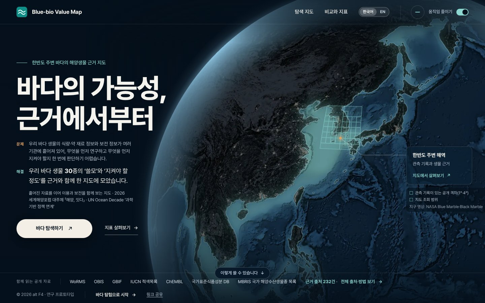
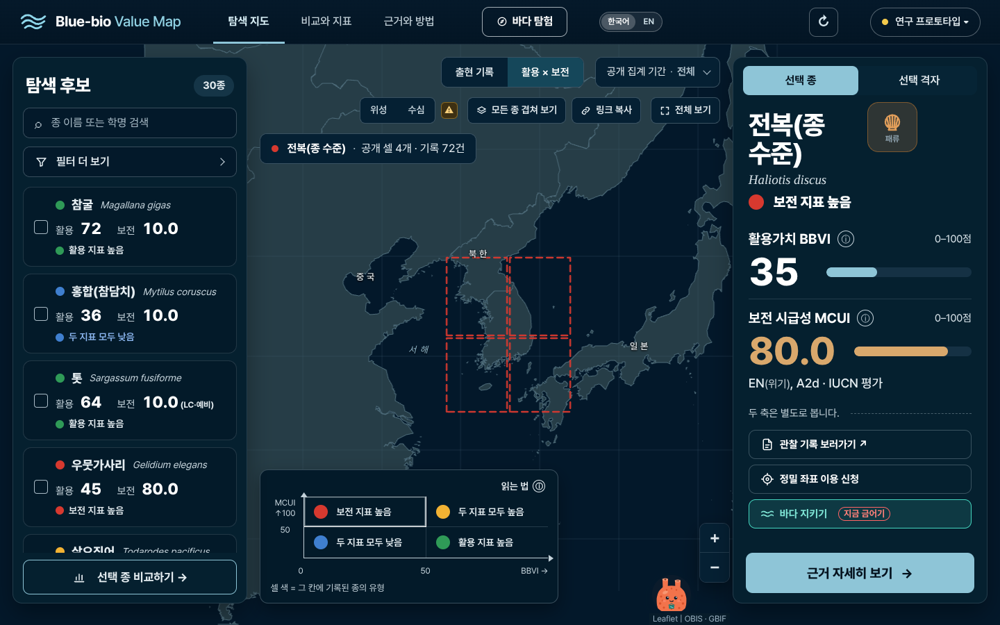
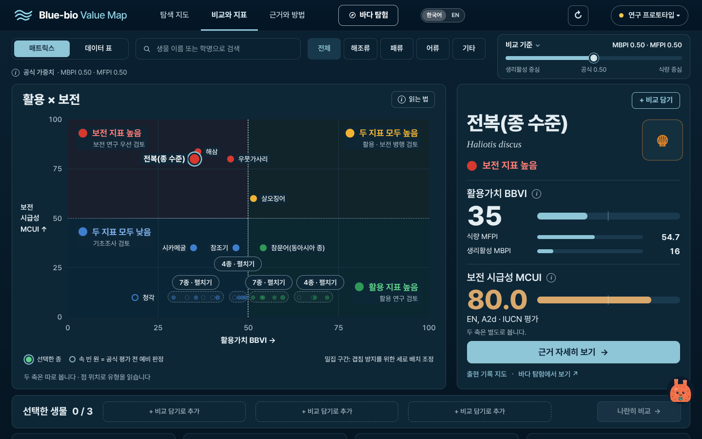
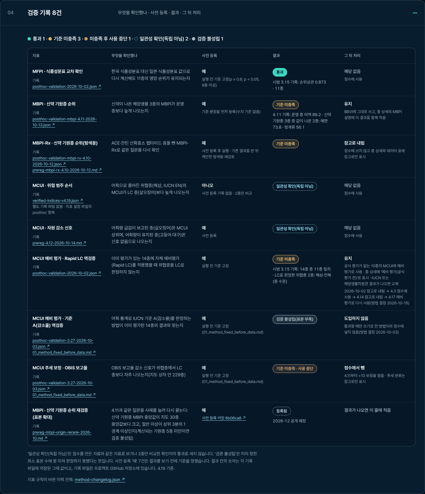
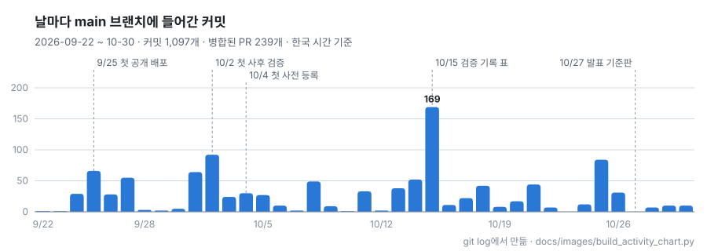
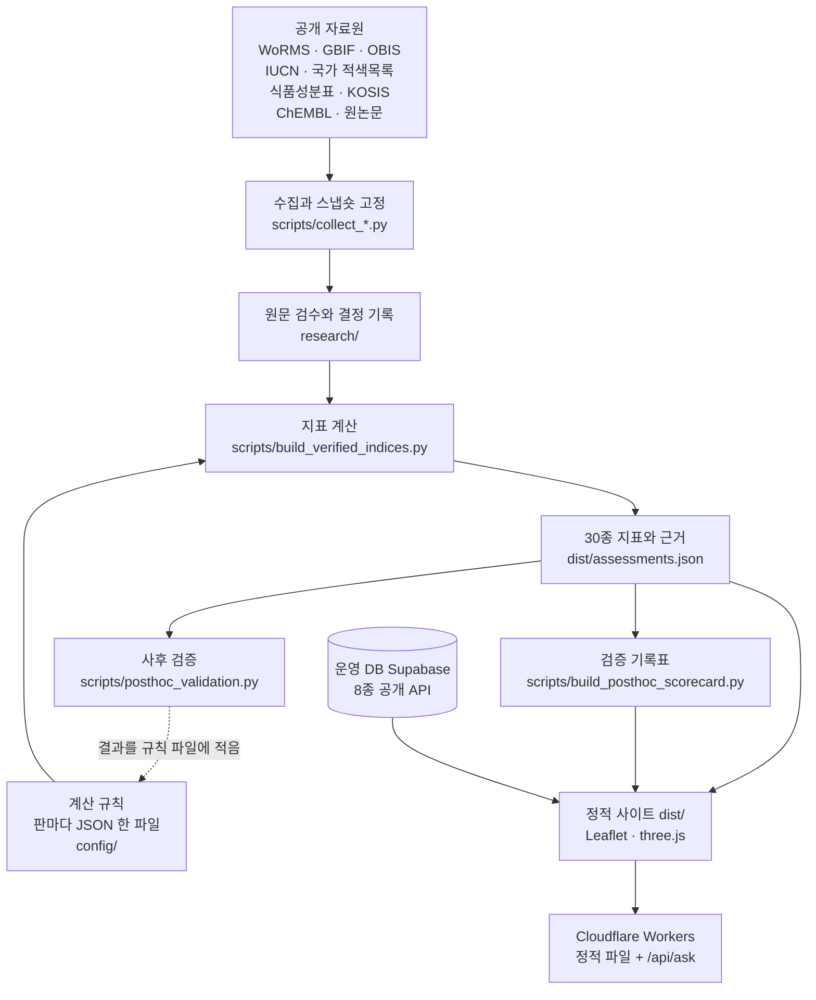

# Blue-bio Value Map

**한반도 주변 바다 생물 30종의 '쓸모'와 '지켜야 할 정도'를 근거와 함께 한 지도에 모은 웹 도구**

[](https://github.com/gyunghun1214/blue-bio-map/actions/workflows/verify.yml)

[사이트 열기](https://blue-bio-map.blue-bio-map.workers.dev) · [스스로 검증한 기록](#스스로-검증한-기록) · [만든 과정](#만든-과정) · [방법 문서](docs/workflow-method.md) · [개발 기록 전체](docs/development-log.md)

alt F4 팀(4명)이 Ocean 20 Challenge 본선에 내려고 2026년 9~10월에 만든 연구 프로토타입이다. 공개 자료를 모아 종마다 식량·생리활성(약 재료) 가치와 보전 시급성을 점수로 보여 주고, 그 점수를 어떤 자료와 규칙으로 만들었는지, 스스로 검증해 보니 어디서 틀렸는지까지 저장소에 남겼다.



## 한눈에

| 항목 | 값 |
| --- | --- |
| 기간 | 2026-09-22 첫 커밋 ~ 10-30 (39일 중 37일 커밋) |
| 커밋 · 병합된 PR | 1,097개 · 239개 |
| 다루는 종 | 30종: 운영 DB에 발행한 8종 + 분류를 확인한 조사 후보 22종 |
| 근거 출처 | 232건 (사이트 첫 화면 기준: 지표 근거 + 지도 셀에 쓴 데이터셋) |
| 공개 출현 기록 | 운영 8종 3,899건(210셀) · 후보 22종 8,908건(567셀), 1° 격자로 묶어 공개(채취에 민감한 종은 4°) |
| 지표 | 4개: 식량 MFPI · 생리활성 MBPI · 보전 시급성 MCUI · 활용 결합 BBVI |
| 지표 규칙 | 52판 (`verified-pilot-1` → `verified-4.19`), 판마다 설정 파일 하나와 변경 이유 |
| 사후 검증 | 8건: 통과 1 · 기준 미충족 3 · 미충족 후 사용 중단 1 · 일관성 확인(독립 아님) 2 · 검증 불성립 1, 그리고 2026-12 공개로 등록한 재검증 1건 |
| 사전 등록 | 문서 17개(초안 2개 포함), 첫 등록 2026-10-04 |
| 자동 검사 | PR마다 GitHub Actions: Node 검사 45개 · 문법 검사 13개 · 자료 재생성 검사 5개 · Python 테스트 496개 · 브라우저 검사(Windows Chrome, WebKit) |

숫자는 2026-10-30 main(`c2c43c6`) 기준이다. 커밋·PR 수는 [`docs/images/build_activity_chart.py`](docs/images/build_activity_chart.py)가 git 기록에서 센다.

## 왜 만들었나

- 야생 전복은 IUCN 적색목록에서 위기(EN, 2022 평가)인데, 국내 전복류 생산의 99.6%는 양식이다(KOSIS 어업생산동향조사 2022~2024: 양식 69,695톤 ÷ 전체 69,959톤, [계산과 출처](docs/발표_숫자_출처.md)).
- 같은 종이라도 "얼마나 쓸 수 있나"와 "얼마나 지켜야 하나"의 답이 다르다. 전복은 활용 35점, 보전 80점이다. 둘을 평균 내면 57.5점이 되어 어느 쪽 이야기인지 사라진다. 그래서 두 점수를 합치지 않고 두 축으로 따로 보여 준다.
- 식량·약 재료 정보와 보전 정보는 여러 기관에 흩어져 있다. 무엇을 먼저 연구하고 무엇을 먼저 지켜야 할지 한 화면에서 판단하기 어렵다.

## 무엇을 만들었나

**탐색 지도.** 종을 고르면 기록이 있는 공개 격자가 지도에 나온다. '활용 × 보전'으로 바꾸면 격자를 그 종의 유형 색으로 칠한다. 원좌표와 기록 ID는 공개하지 않고, 전복·피조개·해삼처럼 채취에 민감한 종은 4° 격자로 넓게 묶는다.



**비교와 지표.** 30종을 활용(BBVI)과 보전(MCUI) 두 축에 놓고 네 유형(보전 지표 높음 · 두 지표 모두 높음 · 활용 지표 높음 · 두 지표 모두 낮음)으로 나눈다. 식량과 생리활성의 비중은 슬라이더로 바꿔 볼 수 있다.



**근거와 방법.** 출처마다 조회일·판·이용조건을 적고, 점수 계산 방법과 검증 기록을 화면에서 그대로 보여 준다(아래 [스스로 검증한 기록](#스스로-검증한-기록)).

그 밖에:

- **바다 탐험**: 지구본 위 탐사 지점을 따라가며 종 카드를 보는 교육용 화면(three.js).
- **한국어 | English**: 미리 만든 사전으로만 바꾼다. 화면을 열 때 기계 번역을 부르지 않는다.
- **오프라인 시연**: 발표장 인터넷이 끊겨도 저장한 공개 자료 사본으로 같은 화면을 띄운다([안내](docs/offline-demo.md)).
- **사용법 도우미 '멍이'**: 정해진 FAQ로 답한다. 서버에 API 키가 있으면 FAQ에 없는 질문은 Claude API가 사이트 화면 글과 FAQ만 근거로 답하고, 근거 글에 없는 숫자가 든 답은 내보내지 않는다(`worker/`).

## 스스로 검증한 기록

점수를 만든 뒤, 답을 이미 아는 사례에 다시 돌려 봤다. 8번 중 통과는 1번이다. 결과는 지우지 않고 표에 남겼고, 틀린 방법은 쓰는 범위를 좁히거나 점수에서 뺐다. 이 표는 사이트 '근거와 방법'의 접힘 04에도 같은 내용으로 나온다([`reports/posthoc-scorecard.csv`](reports/posthoc-scorecard.csv)).

| # | 무엇을 확인했나 | 결과 | 그 뒤 처리 |
| --- | --- | --- | --- |
| 1 | **MFPI(식량)**: 한국 식품성분표 대신 일본 식품성분표로 다시 계산해도 11종의 영양 순위가 유지되나 (기준 실행 전 고정: ρ ≥ 0.6) | **통과**, 순위상관 0.873 | 점수에 사용 ([기록](research/verified-indices/posthoc-validation-2026-10-02.json)) |
| 2 | **MBPI(생리활성)**: 신약이 나온 해양생물 3종의 MBPI가 운영 종보다 높게 나오나 | **기준 미충족**: 운영 종 미역 89.2, 신약 기원종 해면 73.8 · 멍게류 56.1 | 유지하고 종 상세에 이 결과를 함께 적음. 사례를 늘린 재검증을 사전 등록 ([기록](research/verified-indices/posthoc-validation-mbpi-4.11-2026-10-13.json)) |
| 3 | **MBPI-Rx**: 펩타이드 두 층을 뺀 보조 지표로 같은 질문 (2의 결과를 본 뒤 제안한 탐색적 재검토) | **기준 미충족** | 점수에 쓰지 않고 참고로만 표시 ([사전 등록](research/verified-indices/prereg-mbpi-rx-4.10-2026-10-12.md)) |
| 4 | **MCUI(보전)**: 위협종(해삼, IUCN EN)이 LC 종(살오징어)보다 높게 나오나 | 일관성 확인(독립 아님, 2종 비교) | 점수에 사용 |
| 5 | **MCUI**: 어획량이 급감한 종(살오징어)은 상위에, 유지된 종(고등어·대구)은 신호 없음으로 나오나 | 일관성 확인(독립 아님, 점수와 같은 자료) | 점수에 사용 ([사전 등록](research/verified-indices/prereg-4.12-2026-10-14.md)) |
| 6 | **MCUI 자체 예비평가**: 이미 평가된 14종에 돌렸을 때 위협종을 LC로 판정하지 않나 | **기준 미충족**: 14종 중 11종 일치, 위협종 해삼·전복을 LC로 판정 | 공식 평가가 없는 10종에만 '예비 평가(공식 평가 전)'로 표시해 쓰고, 공식 결과가 나오면 바꾼다 ([기록](research/verified-indices/posthoc-validation-2026-10-02.json)) |
| 7 | **MCUI 기준 A(감소율)**: 어획 통계로 IUCN 기준 A를 판정하는 방법이 기존 평가 14종과 맞나 | 검증 불성립(표본 부족) | 도입하지 않음. 통과할 때만 쓰기로 미리 정한 방법 ([기준](research/verified-indices/posthoc-3.27/mcui-criterion-a/01_method_fixed_before_data.md)) |
| 8 | **MCUI 추세 보정**: OBIS 보고율 감소 신호가 위협종에서 더 자주 나오나 (지도 범위 229종) | **기준 미충족**, 사용 중단 | +10 보정을 점수에서 뺌 (4.11부터) ([기준](research/verified-indices/posthoc-3.27/mcui-obis-trend/01_method_fixed_before_data.md)) |
| 9 | **MBPI 재검증(표본 확대)**: 2와 같은 질문을 신약 기원종 사례를 늘려 다시 | 사전 등록됨 (커밋 `6b06ca8`) | 결과 2026-12 공개 예정. 통과하지 못해도 같은 자리에 적는다 ([사전 등록](research/verified-indices/prereg-mbpi-origin-rerank-2026-10.md)) |

<details>
<summary>사이트 '근거와 방법' 04 검증 기록 화면으로 보기</summary>



</details>

- **사전 등록**: 2026-10-04부터는 기준을 값 계산 전에 먼저 커밋하고, 결과를 본 뒤에는 그 문서를 고치지 않는다. 처음 2주는 그러지 못했다. [방법 변경 기록](research/method-changelog.json)에 따르면 규칙을 바꾼 35판 중 23판은 결과를 본 뒤 정했고, 12판은 순서 기록이 없다.
- **6번은 네 번 오갔다**: 10/2 참고로 내림 → 10/5 점수에 사용 → 10/14 참고로 내림 → 10/15 공식 평가가 없는 종으로 범위를 좁혀 다시 사용. 판마다 이유가 [방법 변경 기록](research/method-changelog.json)에 있다.
- **같은 자료로 다시 만들기**: `python scripts/build_verified_indices.py --check` 한 줄이면 공개 점수를 같은 입력·같은 규칙으로 다시 계산해 공개본(`dist/assessments.json`)과 글자 하나까지 같은지 확인한다.

## 만든 과정

<picture>
  <source media="(prefers-color-scheme: dark)" srcset="docs/images/activity-dark.svg">
  
</picture>

| 날짜 | 한 일 |
| --- | --- |
| 9/22 | 첫 커밋: 출처를 단 공개 출현 기록 스냅숏으로 지도 시제품 |
| 9/25 | 첫 공개 배포(Cloudflare Workers), 조사 후보 22종을 더해 30종 |
| 10/2 | 첫 사후 검증: MFPI 통과, 자체 예비평가 기준 미충족 |
| 10/4 | 첫 사전 등록: 값을 계산하기 전에 기준만 담은 커밋 |
| 10/15 | 검증 기록 표와 방법 변경 기록(하루 커밋 169개로 가장 많은 날) |
| 10/21 | MBPI 재검증 사전 등록(2026-12 공개 예정) |
| 10/24 | 한국어 / English 화면 |
| 10/27 | 발표 자료 제출, 이날 화면을 발표 기준판으로 표시 |

<details>
<summary>주별 커밋 수 (표로 보기)</summary>

| 주 | 커밋 |
| --- | --- |
| 09-22 ~ 09-27 | 180 |
| 09-28 ~ 10-04 | 220 |
| 10-05 ~ 10-11 | 131 |
| 10-12 ~ 10-18 | 336 |
| 10-19 ~ 10-25 | 172 |
| 10-26 ~ 10-30 | 58 |

</details>

화면 작업은 대부분 `verification/<날짜>-<주제>/` 폴더에 작업 지시, 고치기 전후 캡처, 확인 스크립트를 남겼다(70개 폴더). 날짜순 전체 기록은 [개발 기록](docs/development-log.md)에 있다.

## 사람과 AI가 나눈 일

> 도구는 제작을 돕고, 판단은 팀이 했다.

- **코드는 거의 전부 AI 코딩 도구(Claude Code)로 썼다.** 병합 커밋을 뺀 커밋 624개 중 313개는 작성자가 Claude이고, 저장소 관리자 계정 커밋 238개 중 227개에도 Claude 공동 작성 표시가 있다.
- **사람은 무엇을 만들고 무엇을 믿을지를 정했다.** 문제 정의, 자료 채택 기준, 검증 설계, 결과를 보고 쓸지 뺄지가 사람 몫이었다. 방법 변경 52판 중 21판이 '팀장 결정'으로 기록돼 있다.
- **AI에게 준 지시도 남겼다.** 작업 지시 원본과, 저장소와 대조해 고친 최종본이 `verification/` 아래 `prompt-original.md`(14개)·`prompt-final.md`(9개)로 있다.
- **새 근거는 따로 확인했다.** 점수를 만드는 종-화합물 연결은 모두 원문으로 검수했다. 근거가 논문 1편이면 0.75, 2편 이상이면 1.0을 곱하는데, 같은 펩타이드를 다른 논문이 다시 재어 값이 비슷할 때(pIC50 차이 1.0 이내)만 2편으로 센다.

## 구조



- 사이트는 빌드 단계가 없다. `dist/`를 그대로 Cloudflare Workers로 내보내고, main에 병합하면 자동 배포된다.
- 지표 계산(`build_verified_indices.py`)은 Python 표준 라이브러리만 쓴다. 바깥 패키지는 엑셀 읽기(openpyxl), 지도 칸의 바다 부분 자르기(shapely), 지구본 영상 굽기(Pillow · NumPy · SciPy)에만 쓴다. 바깥 자료는 조회일과 함께 스냅숏으로 고정해 두고, 다시 계산할 때 그 파일을 읽는다.
- 운영 DB(Supabase)에 닿지 못하면 저장한 공개 자료 사본(`dist/live-snapshot.json`)으로 바꾸고 화면에 그 사실을 표시한다.

## 직접 확인하기

```bash
# 사이트를 내 컴퓨터에서 열기 (Python만 있으면 된다) → http://127.0.0.1:8765/
python -m http.server 8765 --bind 127.0.0.1 --directory dist

# 공개 지표를 같은 입력·같은 규칙으로 다시 계산해 공개본과 같은지
python scripts/build_verified_indices.py --check

# 검증 기록표가 저장된 결과 파일과 같은지
python scripts/build_posthoc_scorecard.py --csv --check

# 점수 하나를 원논문까지 거슬러 보기 (전복 MBPI)
python scripts/lineage.py explain --aphia 397082

# Python 테스트 (CI는 .github/workflows/verify.yml에서 Node·브라우저 검사까지 돈다)
python -m unittest discover -s verification -p "test_*.py"
```

`lineage.py explain`은 이런 식으로 점수를 끝까지 풀어 보인다.

```text
전복(종 수준) Haliotis discus (AphiaID 397082) · MBPI 15.6 · run verified-4.19 (c2c43c6)
└─ ★ 최댓값 = MBPI SEQ:AMN  층 ahtpdb-ace-ic50-hhl-cushman-cheung
    값 3.498 → 백분위 20.74 × 근거 0.75 (independent DOIs 1) = 15.554
    연결: 원논문 · 서열 기반 합성 펩타이드 · 종 일치 (원논문 검수) (Haliotis discus)
      https://doi.org/10.1007/s00217-014-2315-8
```

## 저장소 안내

| 폴더 | 들어 있는 것 |
| --- | --- |
| [`dist/`](dist/) | 공개 사이트 그대로. `app.js`(지도·비교·방법), `assessments.json`(30종 지표와 근거), `expedition.*`(바다 탐험) |
| [`worker/`](worker/) | Cloudflare Worker: 사용법 도우미의 `/api/ask` |
| [`scripts/`](scripts/) | 자료 수집·검수, 지표 계산, 사후 검증, 검증 기록표·방법 변경 기록 만들기 |
| [`config/`](config/) | 지표 규칙 판마다 설정 파일 하나(`verified-indices-v*.json`) |
| [`research/`](research/) | 원문 검수 기록, 사전 등록, 결정 기록, 사후 검증 결과, 방법 변경 기록 |
| [`reports/`](reports/) | 검증 기록표, 판별 자료원 변경·점수 계보 점검 보고 |
| [`verification/`](verification/) | 자동 검사와 날짜별 화면 점검 기록(작업 지시·전후 캡처·확인 스크립트) |
| [`docs/`](docs/) | [방법 문서](docs/workflow-method.md), [근거 입력 형식](docs/evidence-schema.md), [발표 숫자 출처](docs/발표_숫자_출처.md), [오프라인 시연](docs/offline-demo.md), [개발 기록](docs/development-log.md) |
| [`data/`](data/) | KOSIS 원자료 |

## 자료와 이용조건

- 자료원마다 조회일·판·이용조건을 `dist/assessments.json`의 `sources`에 두고 사이트 '근거와 방법'에 그대로 보인다. 출처별 상업 이용 구분은 [`research/license-matrix-2026-10-15.md`](research/license-matrix-2026-10-15.md)에 있다.
- CC BY-NC 기록이 든 격자는 비상업 연구용으로 표시한다. 격자는 출현 기록 집계이며 분포나 자원량이 아니다.
- 지표는 모두 시범 지표다. 사후 검증을 통과한 것은 MFPI 하나다(위 표).

## 팀

alt F4, 4명. 팀장 이경훈([@gyunghun1214](https://github.com/gyunghun1214))이 저장소를 관리했다. 팀원 커밋은 [@sunnykim23](https://github.com/sunnykim23), [@yennybear](https://github.com/yennybear), [@doyoun0824](https://github.com/doyoun0824), [@limyw](https://github.com/limyw)에서 왔다. 팀원이 모은 조사 자료는 [`research/`](research/README.md)의 양식으로 받아 `scripts/check_research.py`로 검사했고, 원문을 확인한 것만 근거로 썼다.

## In English

Blue-bio Value Map puts 30 marine species around the Korean Peninsula on one map with two separate scores: how useful they are (food and bioactivity, BBVI) and how urgently they need protection (MCUI). `python scripts/build_verified_indices.py --check` rebuilds every published score from pinned public sources and compares it with the published file. We then tested our own indices against cases with known answers: of 8 checks, 1 passed, 4 missed their pre-set criteria (one method was dropped from the score), 2 were consistency checks only, and 1 could not be judged. All of them stay in [`reports/posthoc-scorecard.csv`](reports/posthoc-scorecard.csv) with what we changed afterwards. Built between 22 Sep and 30 Oct 2026 (1,097 commits, 239 merged PRs) by team alt F4, with almost all code written through Claude Code and the judgment calls made by the team. Live site: <https://blue-bio-map.blue-bio-map.workers.dev> (Korean and English).
