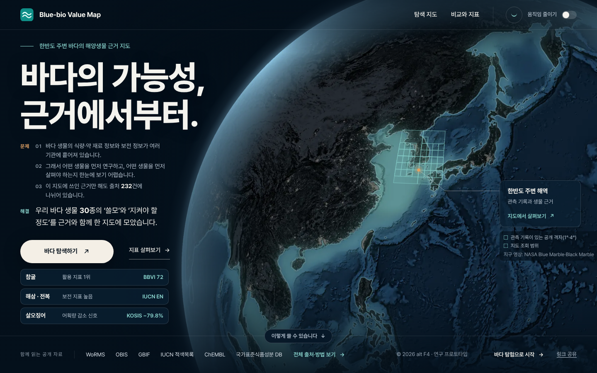
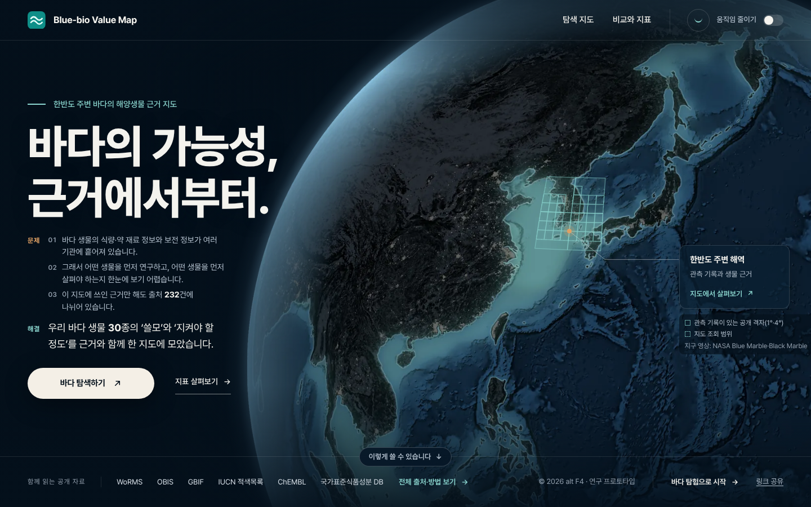
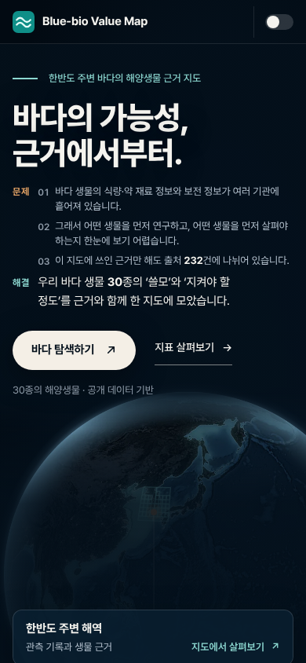

# 첫 화면 예시 카드 3개(`.gate-ex`) 제거 (2026-10-17)

첫 화면 '바다 탐색하기 / 지표 살펴보기' 버튼 아래의 예시 종 카드 세 줄(참굴 활용 지표 1위 · 해삼·전복 보전 지표 높음 · 살오징어 어획량 감소 신호)을
첫 화면에서 통째로 없앴다. 첫 화면은 '문제 → 해결 → 버튼'으로 끝난다. 화면 표시만 바꿨고, 데이터와 다른 화면은 그대로다.

- 기준 커밋: main `ddd8530` (PR #224 머지, 카드가 들어온 커밋). 작업 중 main에 PR #225('이렇게 쓸 수 있습니다' 카드 3장, `c95e00a`)가 들어와 병합했고, 이어서 PR #226('다음 단계' 4줄, `350d643`)도 병합했다.
  `intro.js`·`uicheck.mjs`·`test_intro_ui.mjs` 충돌은 #225의 새 내용을 받은 뒤 카드 부분만 다시 뺐고, `index.html`은 main 쪽을 받아 카드 목록을 지우고 `?v=`를 다시 맞췄다.
  두 번째 병합 뒤 검사·캡처를 다시 돌린 결과가 아래다. '전' 캡처는 `350d643`이다. #226의 `NO_DRAG`(`.gate-below`)에서도 `.gate-ex`만 뺐다.
- 지침: 원본 [`prompt-original.md`](prompt-original.md)(LKH가 올린 `intro-remove-examples-claude-code.md`. 원본이 가리키는
  `prompts/` 폴더는 저장소에 없다), main과 대조해 보완한 [`prompt-final.md`](prompt-final.md).
  원본이 놓친 곳: 카드 클릭 처리(`q('.gate-ex').addEventListener`, 남기면 `null` 오류로 첫 화면의 키보드·움직임 스위치 연결이 끊긴다),
  드래그 제외 목록 `NO_DRAG`, `exampleLinks` 단위 검사의 vm 내보내기, uicheck G-8(카드를 눌러 비교 탭으로 가는 흐름).
  예시를 만드는 곳은 `scripts/`가 아니라 `dist/app.js`의 `gateExamples()`다.

## 바뀐 파일

| 파일 | 지운 것 |
|---|---|
| `dist/index.html` | `<ul class="gate-ex" aria-label="이 지도에서 바로 열어 볼 수 있는 종">…</ul>` 전체(`li[data-ex]` 3개). `intro.js?v=0452995782`, `intro.css?v=11ca00292d` |
| `dist/intro.js` | `renderExamples()`와 `render()` 안의 호출(그 안에 있던 #225 정책 카드의 종 이름 채우기는 `renderUseSpecies()`로 옮김. `exampleLinks()`는 이 채우기가 쓰므로 남김), `copyBoxes()`의 `.gate-ex li` 상자, `NO_DRAG`의 `.gate-ex`, `.gate-ex` 클릭 처리. `enter(target, {hash})`의 `hash` 경로는 남기고 주석만 '종 링크'로 고침 |
| `dist/intro.css` | `.gate-ex`, `.gate-ex.is-on`, `.gate-ex li`, `.gate-ex li:hover/:focus-within`, `.gate-ex p`, `.gate-ex-name`(+`a`, `a:hover`), `.gate-ex li.one … a:after`, `.gate-ex-fact`, `.gate-ex-val`, `.gate:not(.is-ready) .gate-ex`, 휴대폰 쿼리의 세 줄, `(min-width:761px) and (max-height:640px){.gate-ex{display:none}}`. 묶음 두 곳은 `.gate-why`만 남김. 카드를 설명하던 주석 세 곳 고침 |

여백은 손대지 않았다. 넓은 화면은 글 묶음이 세로 가운데로 내려와 버튼 아래가 비어 보이지 않고, 좁은 화면은 버튼 바로 아래에 '30종의 해양생물 · 공개 데이터 기반' 줄과 지구본이 온다.

그대로 둔 것: `app.js`(`gateExamples()`와 첫 화면에 넘기는 `examples`, 해시 그대로. 정책 카드의 '(해삼·전복)'이 이 자료에서 나온다), #225의 '이렇게 쓸 수 있습니다' 카드, `dist/*.json`, 첫 화면의 다른 문구·버튼·오른쪽 카드·아래 공개 자료 줄, 지구본, 움직임 줄이기, 다른 탭, `expedition.html`, 멍이.
`dist/_headers`의 immutable 목록에 `/intro.js`, `/intro.css`가 있음을 확인했다.

## 검사

| 구분 | 내용 |
|---|---|
| 고친 검사 | `test_intro_ui.mjs`: intro.js·intro.css에 `renderExamples`·`gate-ex`·`data-ex`가 없다(`exampleLinks` 단위 검사는 함수가 남으므로 그대로). #225의 정책 카드 채우기 검사를 `renderUseSpecies()`의 `sp.textContent`로 맞춤. 순서 검사 '… → 버튼 → 카드' → '… → 버튼'. 카드 마크업 검사 → `.gate-ex`·`data-ex`가 첫 화면 HTML에 없고, 세 문구가 첫 화면(`<section class="gate-uses">` 앞)에 없다(정책 카드의 '‘보전 지표 높음’ 종'은 #225 문구). 약점 낱말 검사에서 `exHtml` 제거 |
| 고친 검사 | `uicheck.mjs`: G-1b(버튼 아래 카드 위치 조건 제거), G-1c(카드 내용 → DOM에 `.gate-ex`·`[data-ex]`가 없고 첫 화면 글자에 세 문구가 없다), G-1d(지구본 계산에서 카드 상자 제거, 글 상자 수 하한 7 → 6), G-8(카드 눌러 비교 탭 → 첫 화면에 `#s=` 종 링크와 카드 목록이 없다), #225 G-1e(정책 카드 종 이름의 기대값을 `.gate-ex` 카드 대신 `gateExamples()`의 보전 예시에서 읽음). G-1c 문구 검사는 `.gate-center` 안으로 한정 |
| 새 검사 | 위 G-1c·G-8, `test_intro_ui.mjs`의 HTML·문구 부재 검사, 이 폴더의 `capture.mjs` |
| 지운 검사 / 건너뛴 검사 | 없다 |

결과(이 커밋 기준):

- CI와 같은 검사: `node verification/test_*.mjs` 전부 통과(`test_detail_render.mjs`는 CI에 없고 main에서도 실패), `python scripts/build_expedition_stops.py --check` 통과, Python 3.12 `unittest` 484개 통과(건너뜀 3, 원래 있던 것)
- `uicheck.mjs`(병합 뒤): 227 PASS / 4 FAIL. #225의 G-1e·G-1f·G-10, #226 검사 포함 통과. 첫 실행에서 G-1d가 카드 3개가 빠진 글 상자 수 하한 7에 걸려 6으로 고쳤다. 4개는 클라우드에서 지도 타일(GIBS·GEBCO)이 막혀 나는 환경 실패(위성·수심·저장된 '기본'·A-5 공유 링크)로 main에서도 같다
- `capture.mjs`([`before-results.json`](before-results.json) 36/36, [`after-results.json`](after-results.json) 44/44): 1440·1100·768·390px, 움직임 줄이기 켬/끔 모두
  가로 넘침 0, 지구본이 글·버튼과 겹치지 않음(넓은 화면은 글 오른쪽 끝과 지구본 가장자리 사이가 1440 28.7px · 1100 22px, 좁은 화면은 지구본 띠가 글 아래에서 시작),
  '바다 탐색하기'가 첫 화면 안, 콘솔 오류 0, 카드 흔적 0. 1440에서 `.gate-hero` 안의 범례가 3–4px 밖으로 나가는 것은 전부터 있던 것이고 페이지 가로 스크롤은 생기지 않는다

## 캡처

| 전 1440 | 후 1440 | 후 390 |
|---|---|---|
|  |  |  |

다시 찍기: `dist/`를 `127.0.0.1:8765`로 띄우고 `FIXTURE=dist/live-snapshot.json node verification/2026-10-17-intro-remove-examples/capture.mjs <출력 폴더> after`.
전 화면은 main을 다른 포트로 띄워 `… <출력 폴더> before http://127.0.0.1:8766/`.
