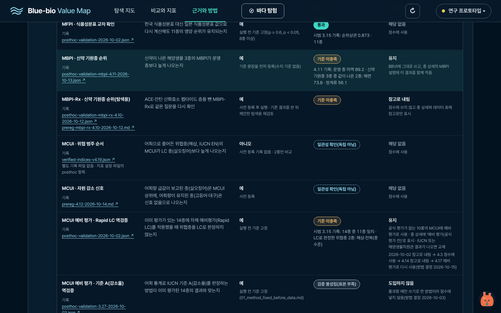
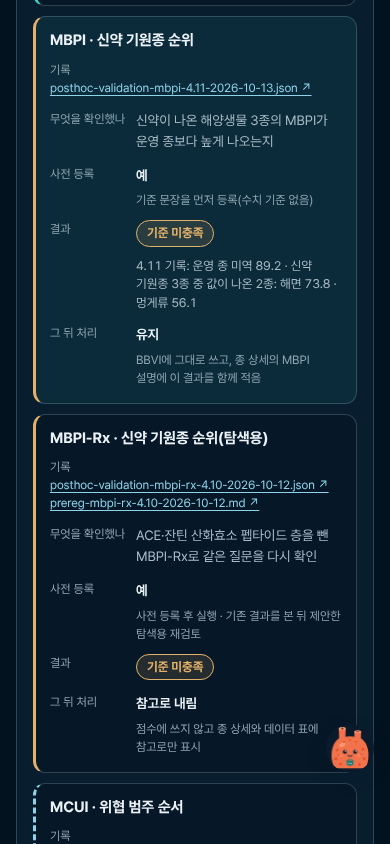
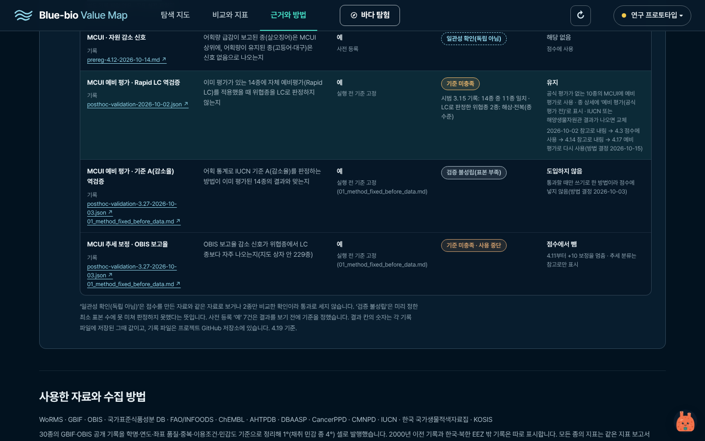
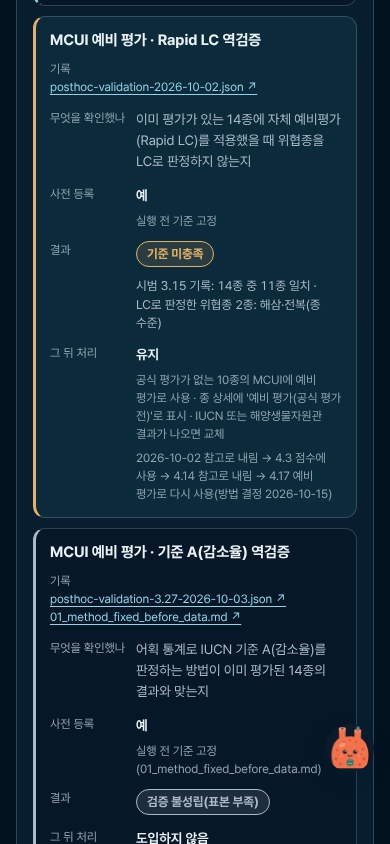
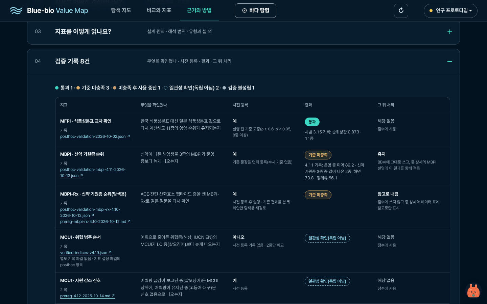
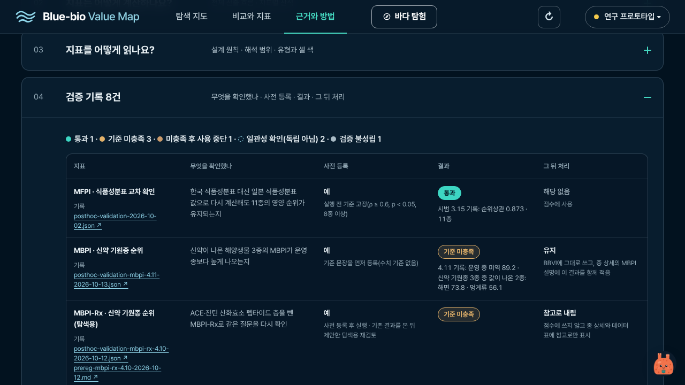
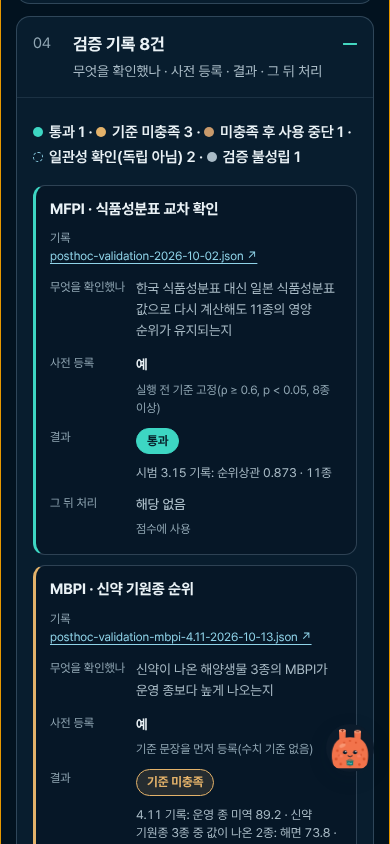
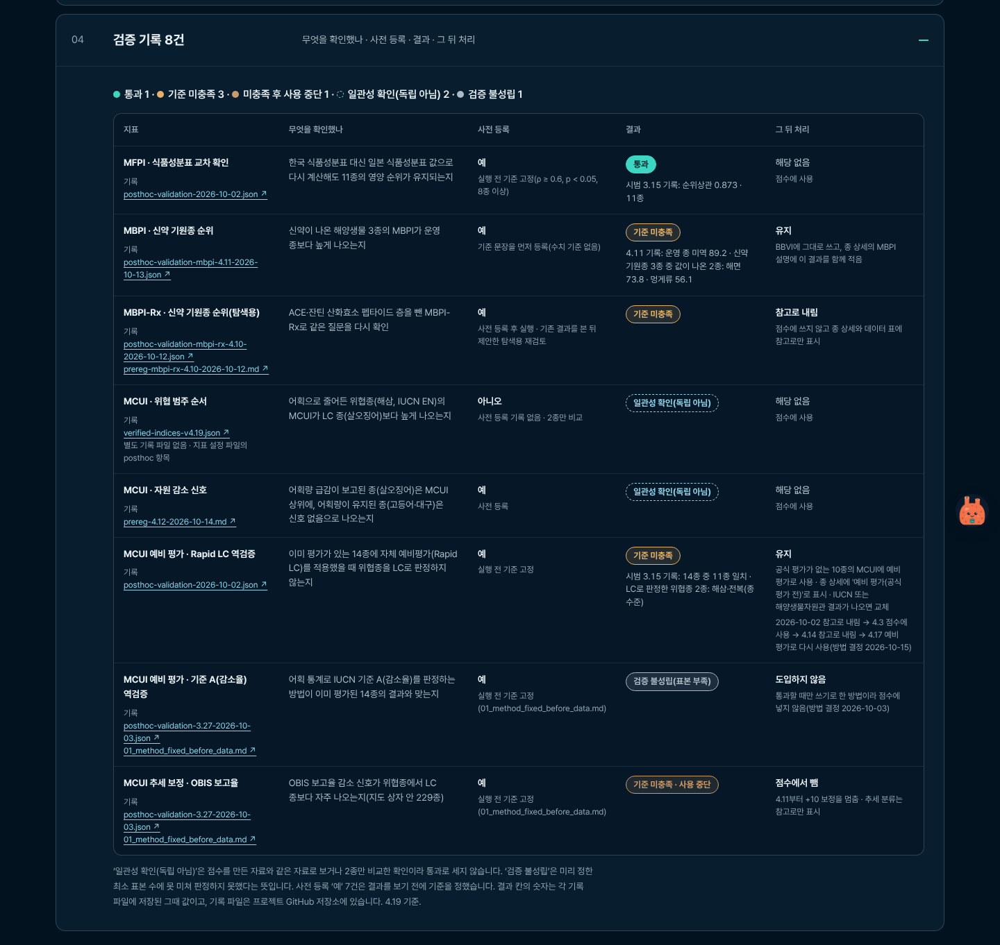
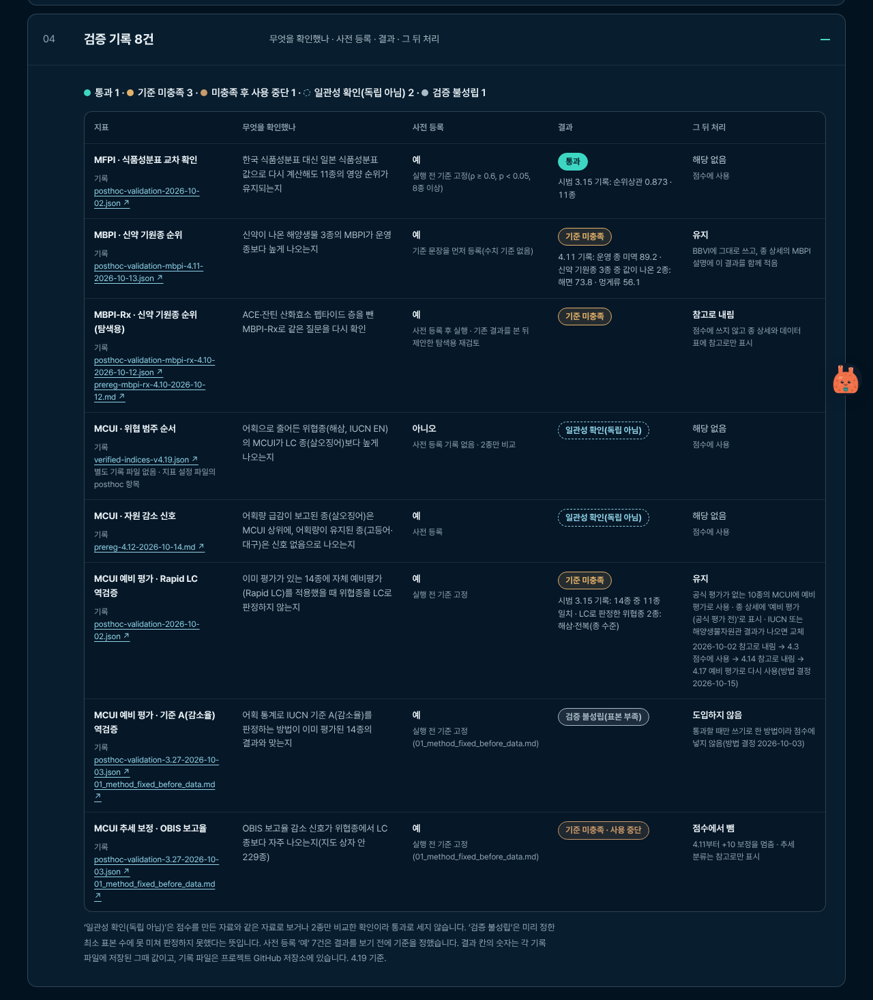
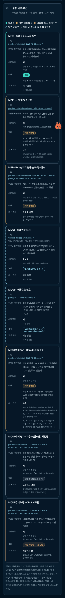

# 검증 기록 8건 표 (프롬프트 1/10)

근거와 방법 탭 접기 04 '검증 기록 8건'(1440 · 1280×720 · 390)과, 종 상세의 '검증 기록 보기'를 눌렀을 때 그 행으로 간 화면(감태 MCUI, 참굴 MBPI)입니다. `method-checks-full-*`은 접기 전체입니다.

찍은 조건은 [상위 README](../README.md)에 있습니다. 캡처 10장.

**go-checks-MBPI-1440.png** (1440px)

**go-checks-MBPI-390.png** (390px)

**go-checks-MCUI_preliminary-1440.png** (1440px)

**go-checks-MCUI_preliminary-390.png** (390px)

**method-checks-1440.png** (1440px)

**method-checks-1280.png** (1280×720)

**method-checks-390.png** (390px)

**method-checks-full-1440.png** (1440px)

**method-checks-full-1280.png** (1280×720)

**method-checks-full-390.png** (390px)

