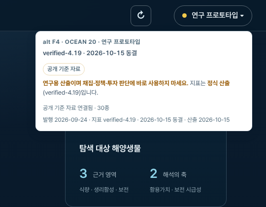
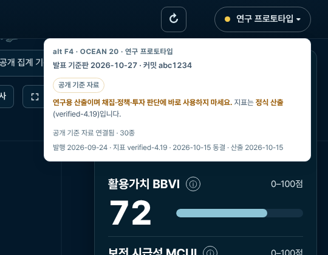

# 제출판 표시 (프롬프트 10/10)

머리글 안내의 버전 줄입니다. `notice-pop-empty`는 `dist/release.json`의 커밋이 빈 지금, `notice-pop-filled`는 로컬에서 커밋을 채워 본 화면입니다.

찍은 조건은 [상위 README](../README.md)에 있습니다. 캡처 2장.

**notice-pop-empty-1440.png** (1440px)

**notice-pop-filled-1440.png** (1440px)

