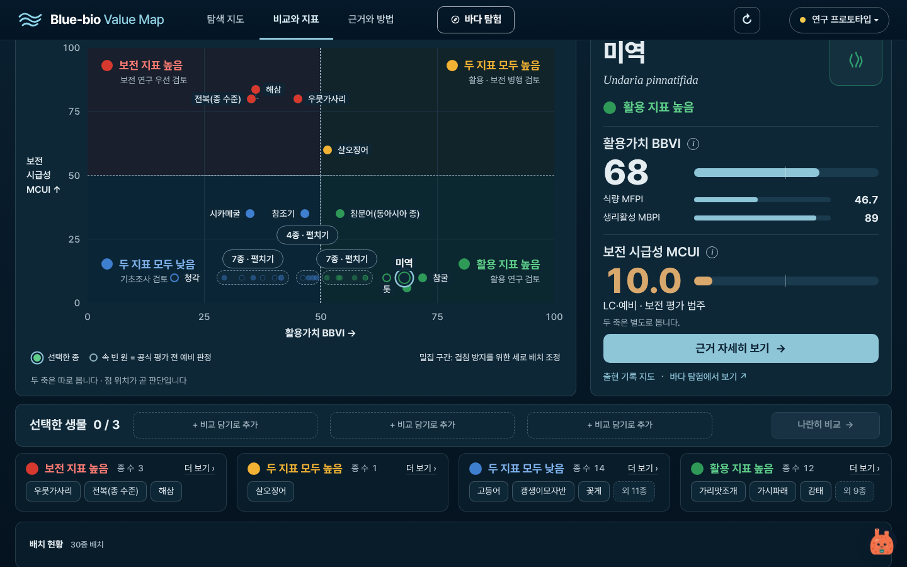
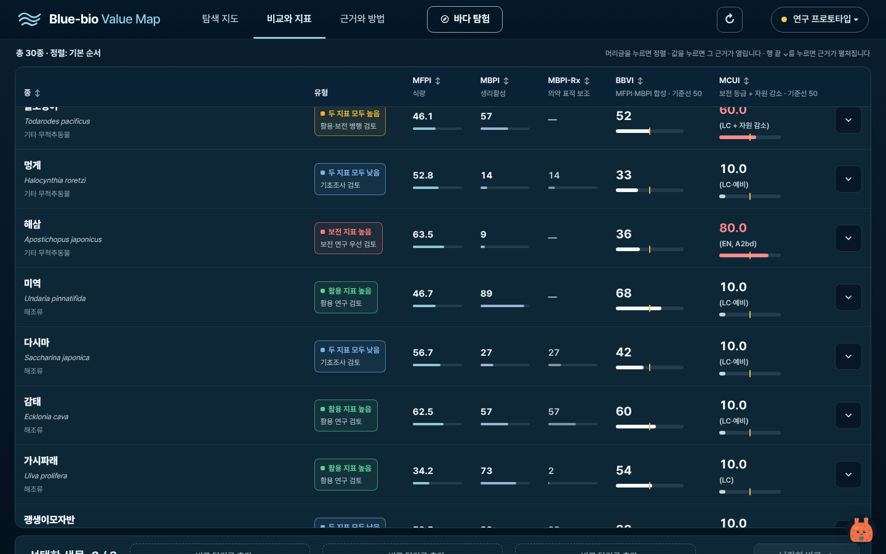

# 예비 판정 10종 '예비' 표시 (프롬프트 2/10)

종 상세 MCUI 칸(감태·미역은 예비, 해삼은 IUCN EN이라 예비 아님), 탐색 후보 카드의 '10.0 (LC·예비)', 매트릭스의 속 빈 원과 범례, 비교 표입니다.

찍은 조건은 [상위 README](../README.md)에 있습니다. 캡처 6장.

**compare-matrix-1440.png** (1440px)

**compare-table-1440.png** (1440px)

**detail-mcui-감태-1440.png** (1440px)

**detail-mcui-미역-1440.png** (1440px)

**detail-mcui-해삼-1440.png** (1440px)

**explore-card-감태-1440.png** (1440px)

