# 운영 주체·의견 창구·다음 단계 시점 (프롬프트 4/10)

첫 화면 전체(1440 · 1280×720 · 390), '다음 단계' 목표 시점, 바닥글의 운영·갱신·의견 보내기, 정밀 좌표 안내 끝의 링크입니다.

찍은 조건은 [상위 README](../README.md)에 있습니다. 캡처 11장.

**coord-dialog-1440.png** (1440px)

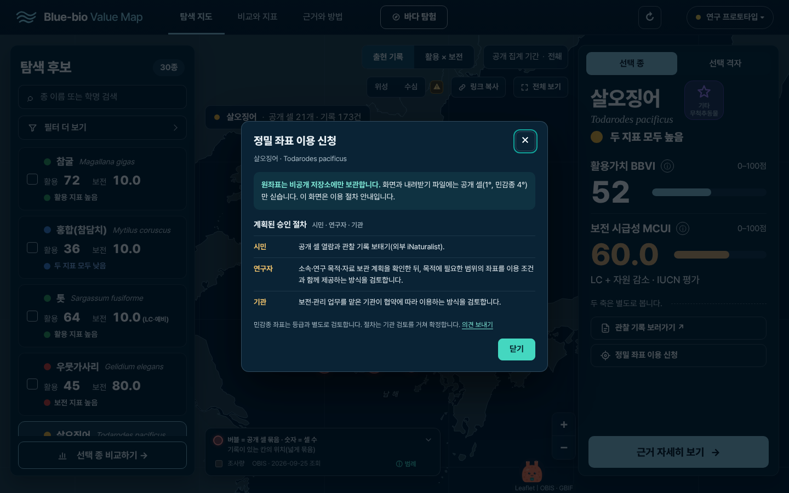

**coord-dialog-390.png** (390px)

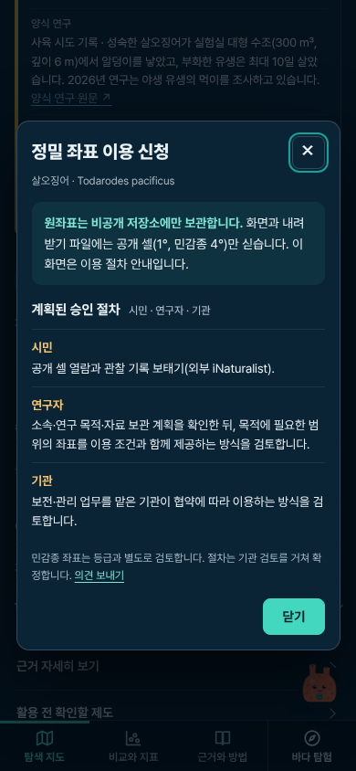

**footer-1440.png** (1440px)

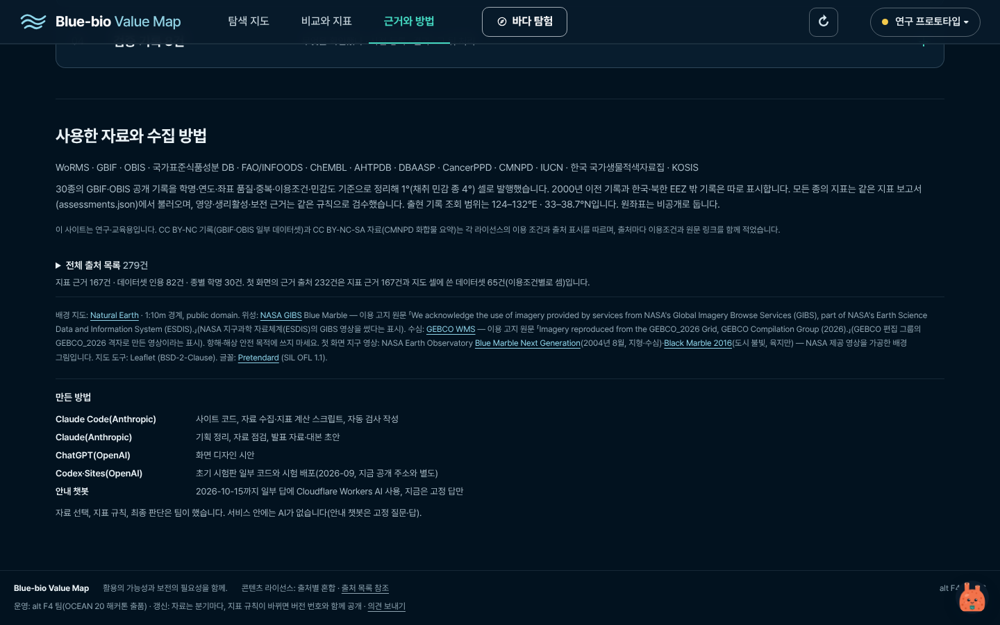

**footer-390.png** (390px)

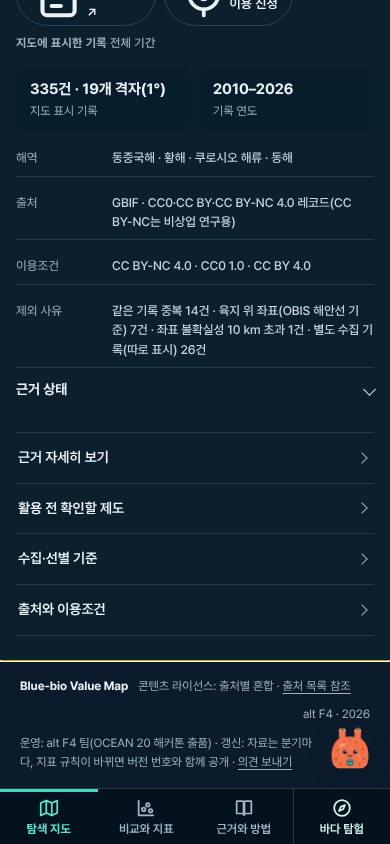

**footer-only-1440.png** (1440px)

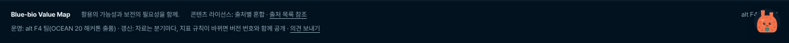

**footer-only-390.png** (390px)

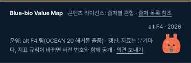

**gate-first-1440.png** (1440px)

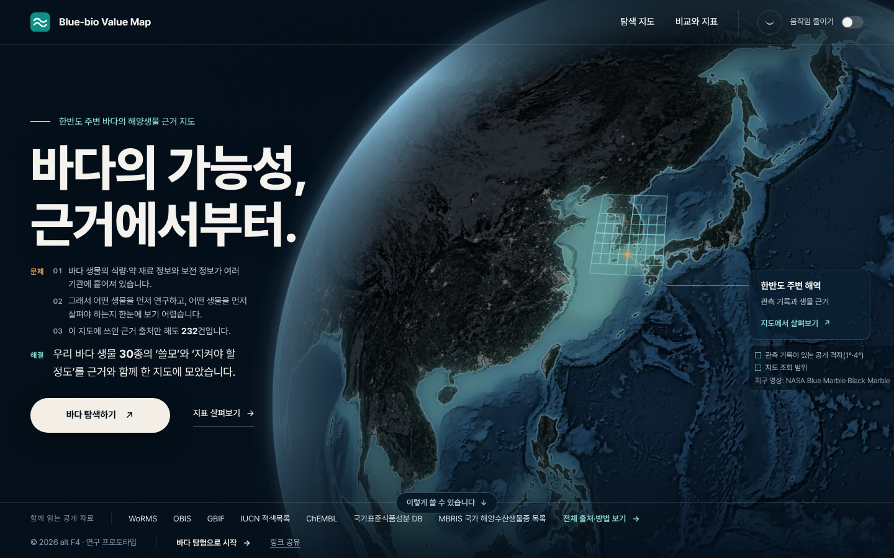

**gate-first-1280.png** (1280×720)

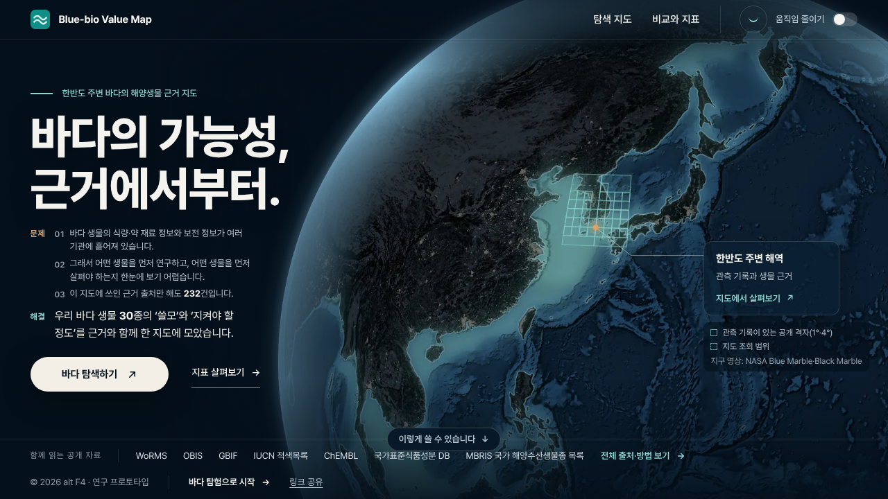

**gate-first-390.png** (390px)

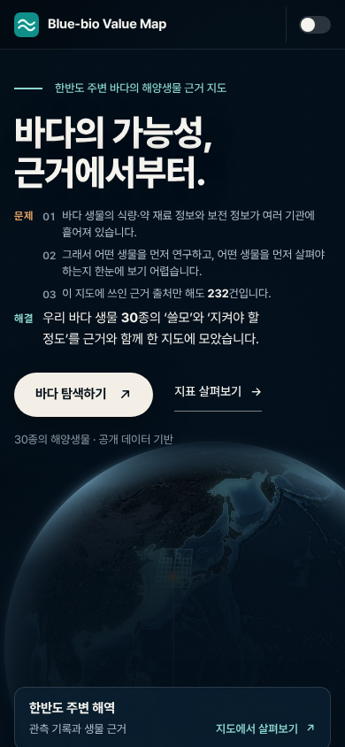

**gate-next-1440.png** (1440px)

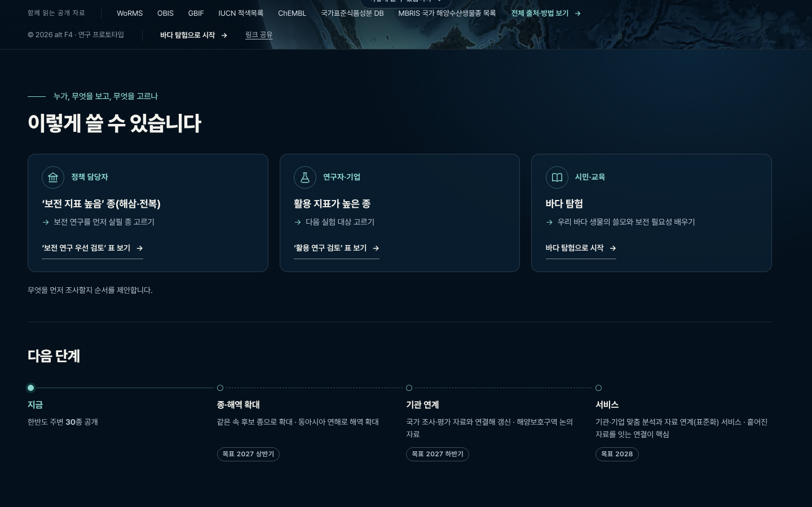

**gate-next-390.png** (390px)

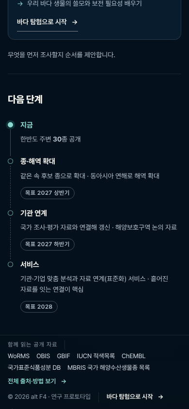
