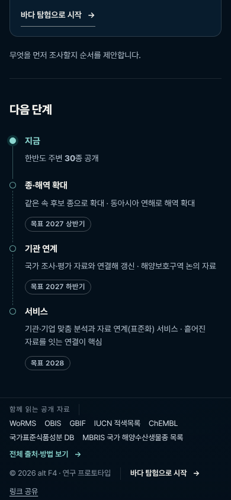
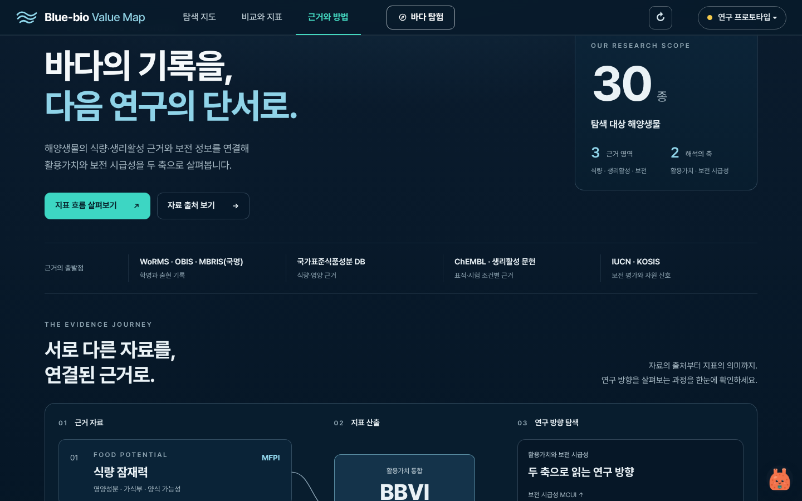
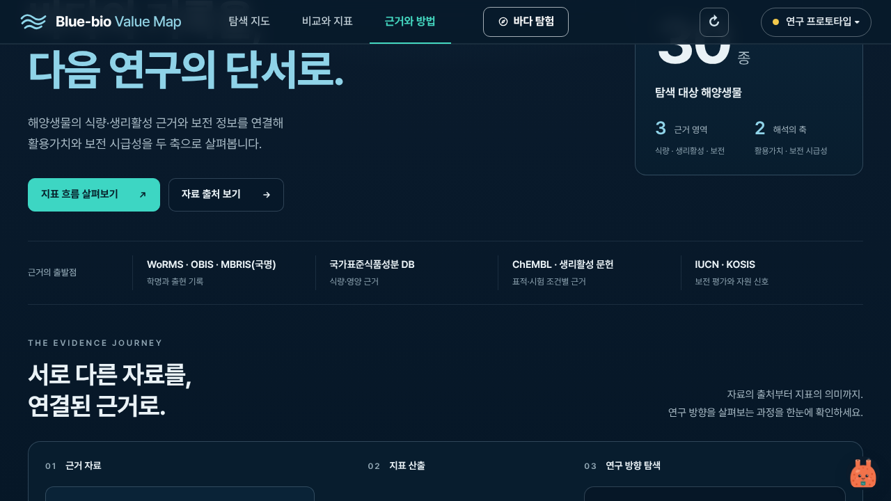
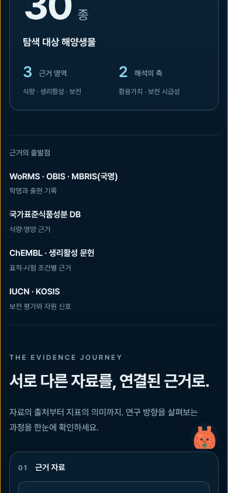

# MBRIS (프롬프트 6/10)

첫 화면 공개 자료 줄의 MBRIS(390. 1440·1280은 [4번 폴더](../4/)의 `gate-first-*` 맨 아래 줄)와 근거와 방법 '근거의 출발점'입니다.

찍은 조건은 [상위 README](../README.md)에 있습니다. 캡처 4장.

**gate-sources-390.png** (390px)

**method-origins-1440.png** (1440px)

**method-origins-1280.png** (1280×720)

**method-origins-390.png** (390px)

