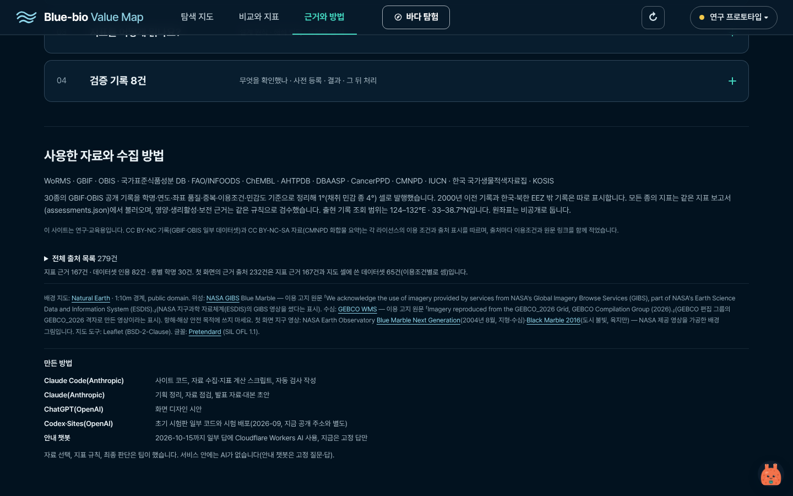
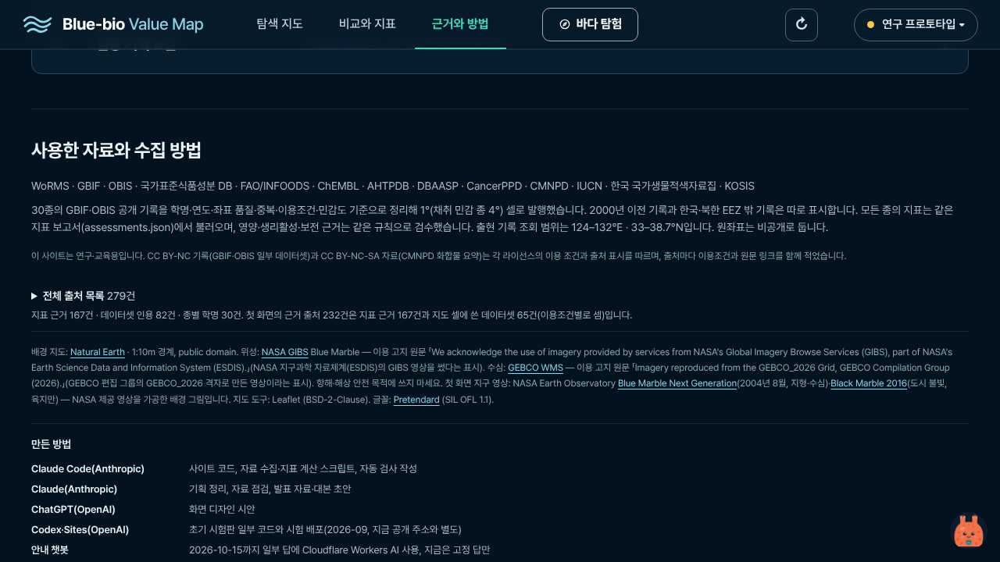
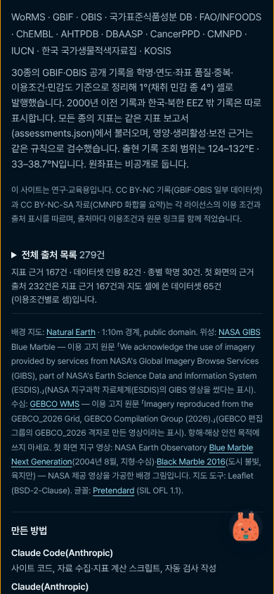

# 출처 232건·279건 (프롬프트 7/10)

근거와 방법 '전체 출처 목록 279건'과 그 아래 구성 줄입니다. 첫 화면의 '근거 출처 232건'은 [4번 폴더](../4/)의 `gate-first-*`에 있습니다.

찍은 조건은 [상위 README](../README.md)에 있습니다. 캡처 3장.

**method-sources-1440.png** (1440px)

**method-sources-1280.png** (1280×720)

**method-sources-390.png** (390px)

