# 휴대폰 화면 개선 (2026-10-25, 밤새 혼자 돌린 판)

- 브랜치 `design/mobile-ux-2026-10-25`, 기준 main `5d79fbe`(PR #260 병합까지). **초안 PR, 병합 금지**: main에 병합하면 Cloudflare로 바로 운영 사이트에 나가므로, 10/27 발표자료 제출 전 LKH가 직접 보고 병합한다.
- 바꾼 범위: **휴대폰 화면(폭 740px 이하, `@media (max-width:740px)` 안)만**. 넓은 화면(1440×900·1280×720)은 main과 픽셀 차이 0(아래 '검사 결과').
- 그대로 둔 것: 점수·숫자·자료(`dist/*.json`, `config/`, `data/`, `research/`, `scripts/build_*.py` 결과물, 점수 계산 코드), 버전, 한국어 화면 글자(새 글자 없음 → `i18n_ui_dict.py add`·기준 파일 다시 만들기 필요 없음). 바꾼 파일은 `dist/theme.css`·`compare.css`·`method.css`·`expedition.css`·`expedition.html`(class 하나)·`app.js`(휴대폰에서만 도는 줄)·`chatbot.js`(휴대폰에서만 도는 줄)와 `index.html`·`expedition.html`의 `?v=`(stamp).
- 열려 있는 다른 PR(#228, #243, #244, #246)의 브랜치는 건드리지 않았다. PR #236(10-18 휴대폰 정리)의 탭바·멍이 시트·접기·숫자 강조는 그대로 두고 그 위에 고쳤다.

## 가장 큰 문제 다섯 (휴대폰에서 실제로 막히던 것)

1. **근거와 방법 탭에서 아래 탭바가 맨 위로 올라가 사라졌다**(P0). 5,000px가 넘는 이 화면을 내리면 다른 탭으로 갈 길이 없었다. → 탭바가 늘 화면 아래.
2. **탐색 지도에서 칸(셀)을 누르면 뜨는 팝업을 지도 위 버튼이 덮어** 제목·숫자가 안 보이고 닫기(×)가 위성/수심 버튼 밑에 숨었다(P0). → 팝업이 지도 안에 들어오고, 연 동안 지도 위 버튼은 숨는다.
3. **종 카드를 누른 뒤 상세가 긴 페이지 맨 아래**(카드 줄에서 약 800px 아래, 길이 1,300px)에 있어 한참 내려가야 했고, 돌아오려면 1,500px를 올려야 했다(P1). → 선택 종 요약을 누르면 아래에서 올라오는 시트로 열리고, 닫으면 있던 자리 그대로(이번 판의 큰 구조 변경 하나).
4. **데이터 표가 1,060px 표 그대로**라 종·유형 칸만 보이고 점수는 상자 안에서 옆으로 밀어야 나왔다(P1). → 종마다 카드 한 장(점수 4칸 + MBPI-Rx).
5. **처음 들어온 첫 화면에 종 카드 줄이 탭바 밑에 숨어**(360px 0px, 390px 19px) 30종을 골라 볼 수 있다는 것을 알기 어려웠다(P1). → 카드 줄 윗부분이 첫 화면에 보인다(52·84·128px).

그 밖에 영어 화면(`?lang=en`) 휴대폰의 겹침·가로 넘침(탭 이름, 지도 버튼, 비교·방법 탭, 바다 탐험 머리글, 종 카드 점수 칸), 누르는 칸 크기, 바다 탐험의 12px 미만 글자 등을 고쳤다. 전체는 아래 표.

## 환경과 확인한 범위

- 이 세션은 클라우드(Linux)에서 저장소를 새로 받아 시작했다. 시작할 때 `git status`에 커밋 안 된 변경이 없어(새로 받은 저장소) 최신 main에서 바로 브랜치를 만들었고, main 비교용은 `git worktree add`로 따로 연 폴더에서 띄웠다.
- 휴대폰: Playwright 1.63 + Chromium(Chrome for Testing 153)으로 **Android Chrome을 흉내**(휴대폰 UA, 터치, 2배, 360×780·390×844·430×932). 로컬 `python -m http.server`(이 브랜치 8765, main 8766).
- 자료: 흐름 따라가기(`walk.mjs`)는 실제 운영 공개 API(이 세션에서 접속됨). 비교 측정·검사(`pc-diff.mjs`, uicheck 등)는 저장 사본 `dist/live-snapshot.json`(FIXTURE). 위성·수심 타일은 처음 받은 것을 `tmp/tile-cache`(git 제외)에 두고 전후·main/브랜치가 같은 그림을 보게 했다.
- 이 환경은 GPU가 없어 WebGL을 껐다: 시작 화면 지구본은 정지 그림, 바다 탐험만 SwiftShader로 WebGL을 켰다.
- **확인 못 한 것**: 실제 휴대폰, iOS Safari, 삼성 인터넷, 화면 키보드가 올라온 모습(멍이 입력칸), 화면 낭독기(VoiceOver·TalkBack), `offline_check.mjs`의 `serve.ps1`(Windows PowerShell 5.1) — 같은 일을 하는 Python 정적 서버로 대신 돌렸다.
- 요청에 있던 '지난 휴대폰 검토(2026-10-18)의 남은 제안 4~9'는 원문 목록(프로젝트 파일 `mobile-review-2026-10-18/README.md`)이 저장소와 PR #236 본문에 없어 번호별로 대조하지 못했다. 대신 9개 흐름을 지금 화면에서 다시 걸으며 문제를 찾았다.
- 확인(측정·캡처로 본 것)과 추정(이 환경에서 재현 못 한 것)을 표의 '근거' 칸에 나눠 적었다.

## 문제 표

우선순위: P0 = 막혀서 할 수 없음, P1 = 할 수는 있지만 많이 어렵거나 잘못 읽음, P2 = 불편·보기 문제. 근거: 확인 = 360·390·430에서 측정·캡처, 추정 = 이 환경에서 재현 못 함.

| # | 화면 | 어려운 행동 | 이유 | 고친 방법 | 우선 | 근거 | 커밋 |
|---|---|---|---|---|---|---|---|
| 1 | 근거와 방법 | 다른 탭으로 가기 | 아래 탭바가 화면 맨 위로 올라가 로고·EN·상태 칩을 덮고, 내리면 머리글과 함께 사라짐. method.css가 머리글에 건 흐림(backdrop-filter)이 고정 탭바의 기준 상자를 머리글로 바꿈 | 740px 이하에서 흐림 끔(휴대폰 머리글은 화면에 붙어 있지 않아 흐림이 안 보임) | P0 | 확인(3폭, 영어도) | 2ebcee9 |
| 2 | 탐색 지도 · 칸 팝업 | 칸 정보 읽기·닫기 | 팝업(최대 480px)이 지도(화면 55%)보다 커서 모드·기간·배경 버튼이 제목·숫자를 덮고 ×는 위성/수심 밑, 아래는 시트에 잘림 | 팝업 연 동안 지도 위 버튼 숨김, 팝업은 지도 안 크기에서 안쪽 스크롤, × 40px, 아래 자동 이동 여백 24px. 그 뒤 좁아진 종 수 칸 이름은 세 칸으로 | P0 | 확인 | ba7af52, fc63378 |
| 3 | 탐색 지도 · 첫 화면 | 30종을 골라 볼 수 있다는 것 알기 | 종 카드 줄이 탭바 밑(360 0px, 390 19px, 430 58px 보임) | 검색·분류 한 줄, 지도 55→50% | P1 | 확인 | 0858608 |
| 4 | 탐색 지도 · 종 상세 | 카드를 눌러 근거를 읽고 목록으로 돌아오기 | 상세가 카드 줄에서 약 800px 아래(길이 1,300px), 돌아오려면 1,500px 위로 | 선택 종 요약 = '근거 자세히 보기' 단추 → 화면을 덮는 시트(✕·닫기·Esc, 닫으면 연 자리 그대로, 시트 안 Tab 가둠) | P1 | 확인 | ffb0367 |
| 5 | 비교와 지표 · 데이터 표 | 종끼리 점수 견주기 | 1,060px 표가 상자 안에서 가로·세로로 따로 스크롤, 첫 화면에 머리글 8칸 중 2~3칸 | 종마다 카드(이름·유형·점수 4칸·MBPI-Rx), 머리글은 정렬 단추 줄. 마크업·값·aria 그대로, CSS만 | P1 | 확인 | de7002b, 31e743e |
| 6 | 비교와 지표 · 매트릭스 | 매트릭스 전체 보기, 점 누르기 | 360×780에서 x축(0–100)이 탭바에 가림. 점이 9–20px | '공식 가중치 · MBPI 0.50 · MFPI 0.50' 줄(바로 위 '비교 기준'과 같은 값)을 휴대폰에서 숨기고 여백 줄임. 점 누르는 범위 44px + 누른 자리에서 가장 가까운 점 고르기 | P1 | 확인 | 5ce4a8e, 4b47b04 |
| 7 | 영어 화면 · 탭바·지도·비교·방법 | 탭 이동, 지도 모드 바꾸기, 비교·방법 보기 | 탭 이름이 옆 칸으로 밀려 겹침(360: 29px), 지도 모드 버튼이 위성/수심과 겹침(360: 47px, 390: 17px), 360 비교 화면이 가로로 넘쳐 탭바가 37px 화면 밖(근거와 방법 탭을 누를 수 없음), 03 접이식 표가 페이지를 455px로 밂 | 영어에서만 탭 칸 고르게·이름 두 줄, 버튼 이름 두 줄, 위 막대·03 칸 min-width 0 | P1 | 확인 | 635069c |
| 8 | 탐색 지도·비교 · 누르는 칸 | 칩·지도 버튼·머리글 단추 누르기 | 첫 화면 누를 것 36개 중 29개가 44px 미만(분야 칩 26, 지도 위 27~29, 확대/축소 34, 비교 담기 20, EN 23, 상태 칩 29) | 칩·지도 위 버튼 40px로, 나머지는 보이는 크기 그대로 누르는 범위만 넓힘(::after) | P1 | 확인 | f7083fc, 10de04f, 7b0c2cd |
| 9 | 영어 바다 탐험 · 첫 화면 | 제목 읽기, 항로 진행 보기 | 360px에서 메뉴가 세 줄로 늘어(아래 끝 y=124) 진행 점을 덮고, 첫 화면 글이 위로 넘쳐 작은 제목은 메뉴 밑, 큰 제목 첫 줄은 '탐험 연출 항로' 밑 | 영어에서만 지금 언어 단추(EN) 숨김(본 화면 휴대폰 머리글과 같은 방식), 휴대폰에서 키보드 안내 숨김(#16) | P1 | 확인 | e3033a9, 202ec3e |
| 10 | 영어 탐색 지도 · 종 카드 | 점수 칸 읽기 | 38px 칸에 'Bioactivity'·'Conservation'이 넘쳐 서로 겹침, '10.0 (LC)'도 옆 값과 겹침(카드 30장) | 영어에서 점수 4칸을 2×2로 | P1 | 확인 | 62d1c95 |
| 11 | 탐색 지도 · 종 카드 | 보전 등급 읽기 | 등급 꼬리표가 다음 칸 밑에 가려 '(VU+감소)'→'(VU+감', '(LC·예비)'→'(LC·예비'(30장 중 13장), '생리활성'도 칸보다 넓음 | 한국어도 2×2(카드 높이 155→210px) | P2 | 확인 | fb3bf9c |
| 12 | 탐색 지도 · 종 상세 | 관찰 기록·정밀 좌표 단추 | 아이콘 크기 규칙이 1180px 이상에만 있어 아이콘 50~106px, 글자 2~3줄 | 아이콘 18px, 단추 44px | P2 | 확인 | f49bc9e |
| 13 | 머리글 · 상태 칩 | 상태 읽기·누르기 | 칩이 overflow:hidden이라 글자 중간에서 잘림(영어 'Research prototy', 오프라인 시연 '…연구 프', 저장 사본 상태 '연구 프로'·'⚠ 저장 사본 · 20'), 넓힌 누르는 범위도 잘림 | 글자만 '…'로 줄이고 ▾·⚠는 남김, 칩 묶음은 머리글 55%까지 줄지 않음, 여백 10→8px | P2 | 확인 | 7b0c2cd |
| 14 | 바다 탐험 · 지점 카드·상세·카드 목록 | 작은 글자 읽기 | 크기 없는 `<small>`이 10.8~11.7px('(지점 4곳)', 이용조건 메모 등) | 12px 아래로 내려가지 않게 | P2 | 확인 | 4b53fb9 |
| 15 | 바다 탐험 · 지점 카드 | 그림 설명 읽기 | '직접 그린 일러스 / 트' | 낱말 단위 줄바꿈 | P2 | 확인 | da039f9 |
| 16 | 바다 탐험 · 첫 화면 | 안내 읽기 | 휴대폰에 없는 휠·방향키·Space·Esc 안내 세 줄 | 휴대폰에서는 '스와이프 휴대폰에서 이동'만 | P2 | 확인 | 202ec3e |
| 17 | 비교와 지표 · 오류 상태 | (없음) | 자료를 못 읽으면 빈 '선택한 생물' 상자가 탭바 위에 떠 있음 | 비어 있으면 숨김 | P2 | 확인 | 7c76089 |
| 18 | 시작 화면 | 카드의 '지도에서 살펴보기 ↗' 누르기 | 높이 20px | 누르는 범위만 넓힘(390: 22→46px) | P2 | 확인 | 87e5006 |
| 19 | 멍이 안내 창 | 추천 질문 고르기 | 열자마자 입력칸에 포커스 → 화면 키보드가 올라와 추천 질문을 가릴 수 있음 | 휴대폰에서는 추천 질문 첫 단추에 포커스(넓은 화면은 입력칸 그대로) | P2 | **추정**(키보드는 실제 휴대폰에서만) | d948e26 |

## 고친 것 (커밋마다 한 줄)

1. `2ebcee9` 근거와 방법 탭: 아래 탭바가 맨 위로 올라가 사라지던 것(머리글 흐림을 휴대폰에서 끔). P0
2. `ba7af52` 지도 칸 팝업: 지도 위 버튼에 가려 제목·닫기가 안 보이던 것. P0
3. `0858608` 탐색 지도 첫 화면에 종 카드 줄이 보이게(검색·분류 한 줄, 지도 50%). P1
4. `ffb0367` 종 상세를 아래에서 올라오는 시트로(이번 판의 큰 구조 변경 하나, 넓은 화면 경로는 그대로). P1
5. `de7002b` 데이터 표를 종별 카드로(CSS만). P1
6. `5ce4a8e` 비교와 지표: 첫 화면에 매트릭스 전체, 점 누르는 범위 44px. P1
7. `635069c` 영어 화면: 탭 이름·지도 버튼 겹침과 비교·방법 탭 가로 넘침. P1
8. `f7083fc` 누르는 칸 키우기: 분야 칩·지도 위 버튼 40px, 나머지는 누르는 범위 44px. P1
9. `d948e26` 멍이 창: 열 때 입력칸 대신 추천 질문에 포커스. P2(추정)
10. `f49bc9e` 종 상세: 관찰 기록·정밀 좌표 단추의 아이콘이 크게 그려져 글자가 접히던 것. P2
11. `7b0c2cd` 머리글 상태 칩: 글자 중간 잘림과 누르는 범위(8의 상태 칩 부분이 실제로는 안 되던 것도 이것으로 고침). P2
12. `4b53fb9` 바다 탐험: 12px보다 작게 그려지던 글자를 12px로. P2
13. `da039f9` 바다 탐험 지점 카드: '직접 그린 일러스트' 낱말 중간 줄바꿈. P2
14. `202ec3e` 바다 탐험 첫 화면: 휴대폰에서 쓸 수 없는 마우스·키보드 안내 숨기기. P2
15. `e3033a9` 영어 바다 탐험: 머리글 메뉴가 세 줄로 늘어 진행 점을 덮던 것. P1
16. `62d1c95` 영어 종 카드: 점수 칸 이름이 서로 겹치던 것(2×2). P1
17. `fb3bf9c` 한국어 종 카드: 보전 등급이 옆 칸 밑에 가리던 것(2×2). P2
18. `4b47b04` 비교와 지표: 넓힌 누르는 범위가 겹쳐 옆 점이 골라지던 것(6의 보완). P1
19. `10de04f` 지도 확대/축소 40px가 실제로 적용되게(8의 보완: !important 규칙에 막혀 34px 그대로였다). P1
20. `7c76089` 비교와 지표 오류 상태: 탭바 위에 떠 있던 빈 상자 숨기기. P2
21. `fc63378` 지도 칸 팝업: 종 수 칸 이름 낱말 중간 줄바꿈(2의 보완). P2
22. `87e5006` 시작 화면: 카드의 '지도에서 살펴보기 ↗' 누르는 범위. P2
23. `31e743e` 데이터 표 카드: 정렬 단추 줄이 표 상자보다 2px 넓던 것(5의 보완, uicheck가 잡음). P2
24. uicheck에 휴대폰 검사 4개 추가(근거와 방법 탭바, 지도 칸 팝업, 상세 시트, 데이터 표 카드).
25. 이 보고서·전후 캡처·점검 스크립트(`walk.mjs`·`pc-diff.mjs`·`common.mjs`).

18·19·21·23은 앞 커밋에서 내가 만든 문제나 효과가 없던 부분을 고친 것이다(커밋 설명에 그대로 적음).

## 전후 캡처 (390×844, 2배)

같은 이름으로 `before/`(main `5d79fbe`)와 `after/`(이 브랜치)에 있다. 360×780·430×932도 같은 이름(`360-…`, `430-…`)으로 있다. 장면 번호: 01 로딩, 02 시작 화면, 03 시작 화면 아래, 04 탐색 지도 첫 화면, 05 말풍선 접힌 뒤, 06 종 카드 줄, 07 분야 칩 켬, 08 카드 누름, 09 상세, 10 상세 끝, 11 목록으로, 12 지도 칸 팝업, 13 활용 × 보전 지도, 14 비교와 지표, 16 매트릭스 점, 17·18 데이터 표, 19·19b 근거와 방법(내린 뒤), 20 접이식 열기, 22·23 멍이, 24·24b 바다 탐험, 25 공유 링크, 26~28 영어, 29 로딩, 30 검색 결과 없음, 30b 빈 응답, 31 API 막힘(저장 사본), 32·33 자료 오류.
09~11은 main에서는 페이지를 내려 상세로 가고, 이 브랜치에서는 시트를 연다(`walk.mjs`).

| 장면 | 전(main) | 후(이 브랜치) |
|---|---|---|
| 04 탐색 지도 첫 화면 | 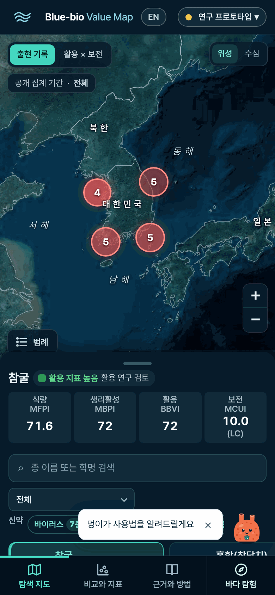 | 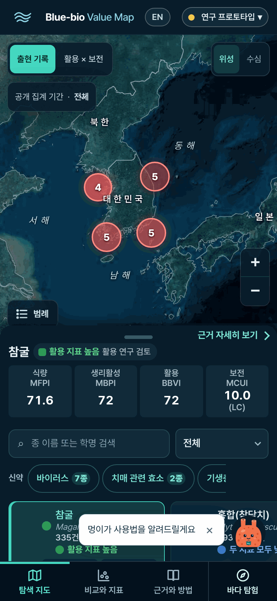 |
| 09 종 상세 | 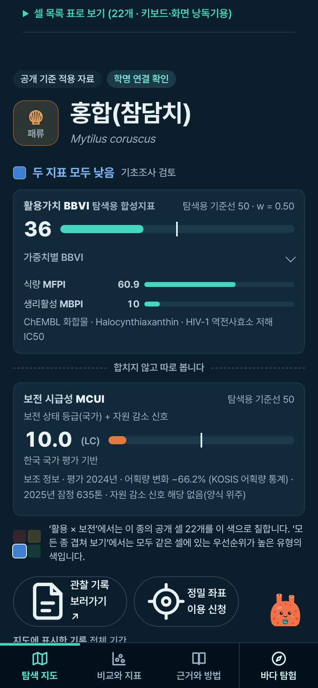 | 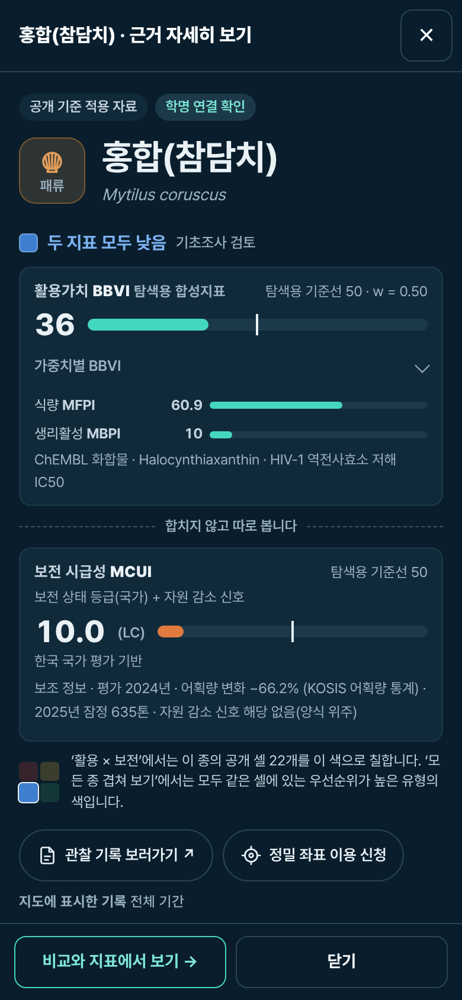 |
| 12 지도 칸 팝업 | 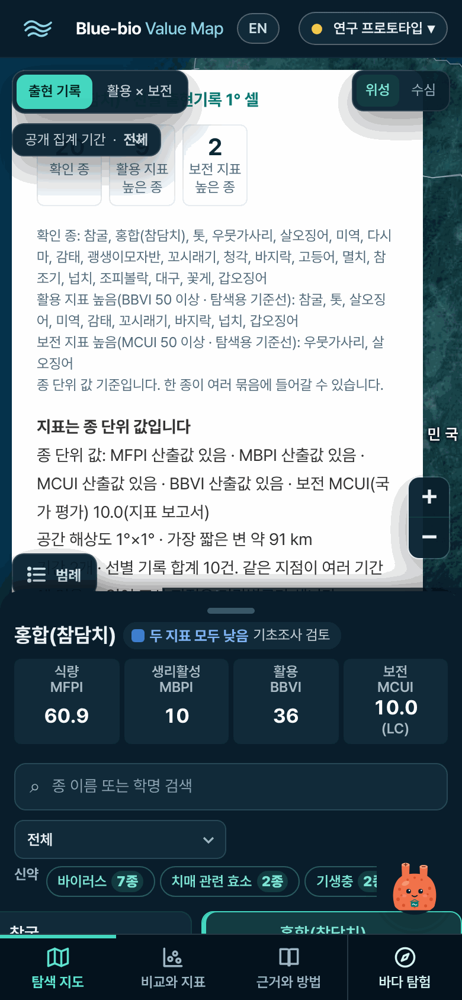 | 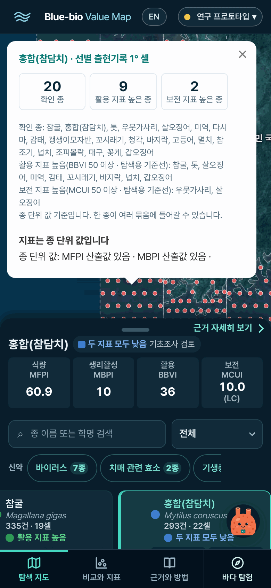 |
| 14 비교와 지표 | 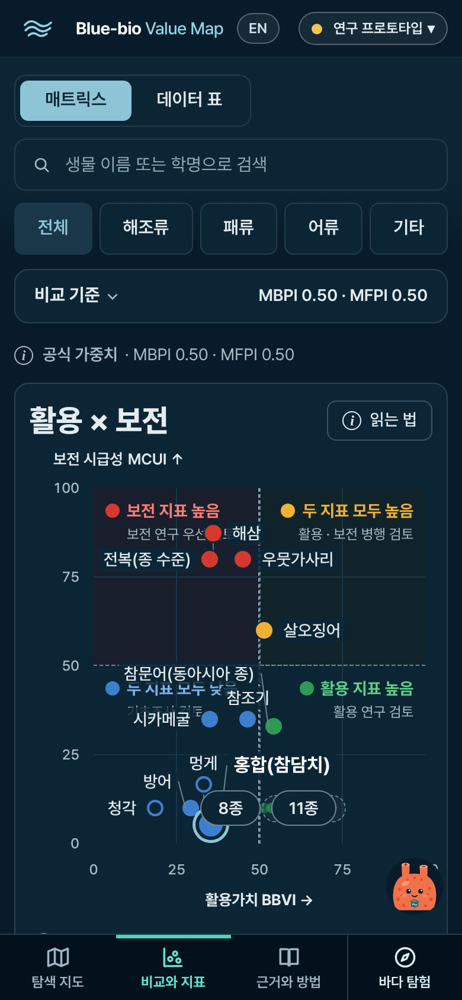 | 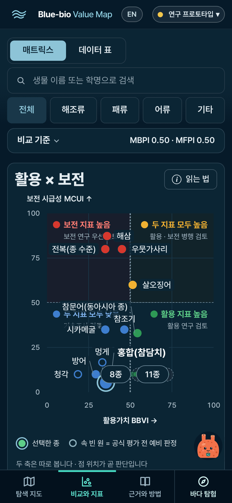 |
| 18 데이터 표 | 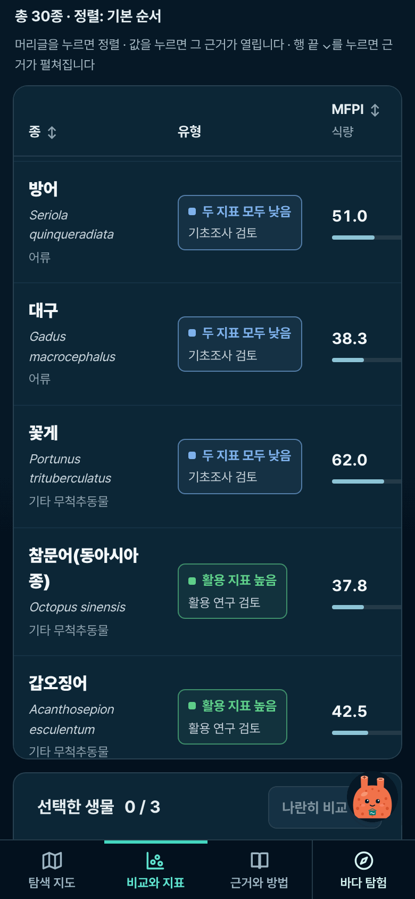 | 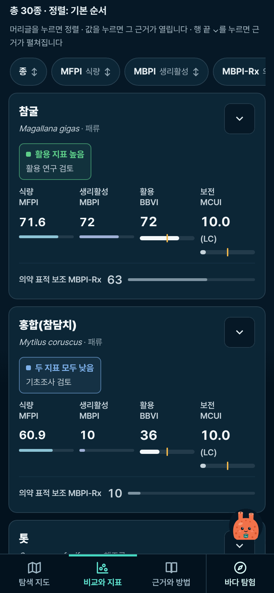 |
| 19b 근거와 방법(내린 뒤) | 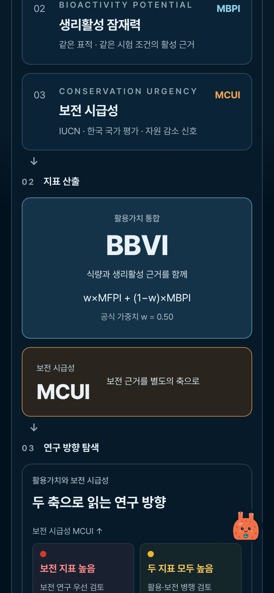 | 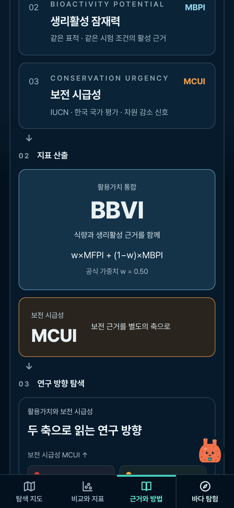 |

## 검사 결과

이 환경: Node 22.23.4, Python 3.12, Chromium(Chrome for Testing 153). CI 스크립트가 Chrome을 직접 띄우는 검사는 root로 도는 이 환경에 맞춰 실행 파일만 `--no-sandbox`로 감쌌다(검사 내용은 그대로).

| 검사 | 이 브랜치 | main | 메모 |
|---|---|---|---|
| CI unit 잡 51개 명령(`verify.yml`) | 51/51 통과 | 51/51 통과 | |
| `uicheck.mjs`(FIXTURE) | 273/273 통과(1회째) | 세 번 모두 48번째 단계에서 멈춤(환경, 아래) | 휴대폰 검사 4개 추가(아래) |
| ↳ 같은 검사, CDP 응답 대기만 30초로 늘린 임시 사본 | 271/273(실패 2: Map wheel) | 268/269(실패 1: Map wheel, 다른 항목) | 아래 '흔들림' |
| `test_i18n.mjs --browser` | 통과 | 통과 | 한국어 화면 = 기준 파일 그대로(바뀐 줄 0), 영어 화면에 표시 없이 남은 한글 0, 링크·점수 같음 |
| `readability_check.mjs`(375·768·1440) | 12px 미만 0, 가로 넘침 0, exit 1 | 같음, exit 1 | 둘 다 같은 1건: 836041 상세의 영어 인용 'Liu et al. 2021(Front Physiol 12:713736)'이 lang 블록 밖(자료 문장, 이번 변경과 무관, CI에 없는 검사) |
| `expedition_check.mjs`(데스크톱·휴대폰·움직임 줄이기·WebGL 없음) | 75/75 | 75/75 | SwiftShader |
| `offline_check.mjs` | 23/23 | 23/23 | `serve.ps1`(Windows PowerShell 5.1) 대신 같은 일을 하는 Python 정적 서버로. **serve.ps1 자체는 미확인** |
| PC 화면 픽셀 비교(`pc-diff.mjs`) | 고정된 차이 0 | (기준) | 아래 |
| 화면 숫자 비교(휴대폰 3폭) | 점수·종 수·셀 수·건수 모두 같음 | (기준) | 아래 |

- **uicheck 흔들림(환경)**: 이 클라우드(2코어)에서는 48번째 단계(30종을 한 번의 evaluate로 차례로 고르기)가 8~11초 걸려 CDP 응답 대기 10초를 넘기곤 한다. main은 기본 그대로 세 번 모두, 브랜치는 두 번째에 거기서 멈췄다(같은 단계를 따로 재면 main 8.2~10.9초, 브랜치 8.4~8.8초로 같은 수준). 그래서 비교용으로 응답 대기만 30초로 늘린 임시 사본(저장소에 넣지 않음)을 main과 브랜치에 똑같이 돌렸다. 남은 실패는 넓은 화면(1560px) 'Map wheel'(휠 줌을 시간으로 재는 검사)뿐이고 두 쪽에서 서로 다른 항목이 흔들렸다(브랜치 1회째는 모두 통과). 이번 변경은 넓은 화면 지도를 건드리지 않는다.
- **uicheck에 더한 휴대폰 검사 4개(390×844)**: 근거와 방법을 1,500px 내려도 탭바·바다 탐험이 화면 바닥 / 지도 칸 팝업이 지도 안, ×(40px 이상)가 가려지지 않음, 지도 위 버튼은 팝업 연 동안만 숨김 / 요약 단추로 상세 시트 열기(화면 전체, ✕에 포커스, 페이지 안 움직임) → Esc로 닫기(포커스 돌아옴, 스크롤 그대로) / 데이터 표: 종별 카드, 화면 밖 칸 0, 상자·페이지 가로 넘침 0. 끝까지 돈 브랜치 실행 두 번(1회째, 30초 사본) 모두 통과. 검사를 끄거나 기대값을 바꾼 것은 없다.
- **PC 화면(넓은 화면) 픽셀 비교**: 1440×900·1280×720 × 움직임 줄이기/보통 × 첫 화면/전체 길이를 두 번씩 찍어, 같은 쪽 두 장끼리의 흔들림을 빼고 남는 '고정된 차이'를 셌다. 시작 화면·탐색 지도·비교와 지표(매트릭스·데이터 표)·근거와 방법 40가지(화면 5 × 크기 2 × 움직임 2 × 첫 화면/전체 길이 2) 모두 **0**. 바다 탐험은 움직임 줄이기에서 0(4가지)이고, 보통 움직임에서는 움직이는 바다 무늬 때문에 같은 쪽 두 장끼리도 9만~50만 픽셀이 달라 픽셀로는 견줄 수 없다(차이는 바다 무늬에만 있고 글자·단추 영역은 같음).
- **화면 숫자(휴대폰 360·390·430, 저장 사본)**: 탐색 지도(목록·요약·상세), 비교와 지표(매트릭스·데이터 표), 근거와 방법, 바다 탐험 카드 목록의 보이는 글자(innerText)에서 숫자를 모아 main과 견줌. 점수·종 수·셀 수·건수는 모두 같다. 다른 것은 비교와 지표의 '0.50' 두 개뿐(휴대폰에서 숨긴 '공식 가중치 · MBPI 0.50 · MFPI 0.50' 줄, 바로 위 '비교 기준' 줄이 같은 값을 보여 줌 → '팀이 정할 것' 4).
- **휴대폰 흐름 따라가기(3폭 × 35장면, 실제 공개 API)**: 가로 넘침 0, 12px 미만 글자 0, 손가락으로 누를 수 없던 탭 0. 전(main): 영어 360px '근거와 방법' 탭 누를 수 없음 1곳, 영어 근거와 방법 455px 넘침(3폭), 바다 탐험 11.67px 글자(3폭).
- **누르는 칸(390px, 눌리는 범위 기준)**: 분야 칩 26→40px, 지도 위 모드·기간·배경 27~29→40px, 확대/축소 34→40px, 비교 담기 칸 20→44px, 머리글 EN 높이 23→40px·상태 칩 높이 29→44px, 매트릭스/데이터 표·읽는 법 34→42px, 시작 화면 카드 단추 22→46px.
- **매트릭스 점 탭 정확도**(점 12개 한가운데를 차례로 누름): 맞게 골라짐 main 10·11·10개 → 브랜치 11·12·11개(360·390·430), 8px 비켜 눌러도 main 10·10·10 → 11·12·12. 남은 1개(톳)는 main에서도 '7종 · 펼치기' 단추가 그 점을 덮는다.
- **한국어 기준 파일**(`verification/i18n-ko-baseline.txt`): 새 화면 글자가 없어 다시 만들지 않았다(`test_i18n --browser`의 '한국어 그대로'가 통과 = 바뀐 줄 0).

## 남은 문제

| 화면 | 남은 것 | 왜 이번에 안 고쳤나 |
|---|---|---|
| 비교와 지표 · 매트릭스(한국어 360px) | 사분면 이름이 낱말 중간에서 줄바꿈('두 지표 모두 높/음', '…병행 검/토') | `word-break:keep-all`로 고쳐 보았으나 점 이름표·'N종' 단추 배치(사분면 이름을 피해 놓는 규칙)가 바뀌어 '7종' 단추가 점을 덮고 '참조기' 이름표가 숨어 되돌렸다. 이름표 배치 규칙과 함께 봐야 한다 |
| 비교와 지표 · 매트릭스 | 점 이름표가 사분면 이름과 겹침(360~430, main과 같음), '톳' 점을 '7종 · 펼치기' 단추가 덮음 | 이름표 배치 규칙(app.js declutter) 문제라 넓은 화면에도 닿는다 |
| 탐색 지도 · 시트 손잡이 | '종 목록·상세 펼치기' 손잡이 높이 24px | 위는 지도, 아래는 요약 단추라 누르는 범위를 넓히면 겹친다 |
| 머리글 | 로고 링크 높이 32px | 이번에는 손대지 않음(첫 화면으로 가는 링크라 덜 급함) |
| 탐색 지도·비교 | 멍이 버튼(48px)이 오른쪽 아래 내용을 덮음(선택 카드의 활용 BBVI 칸, 매트릭스 오른쪽 아래), 첫 화면 말풍선이 7초 동안 카드 줄을 가림 | 멍이 위치·말풍선은 10-18에 정한 것이라 팀이 정할 일 |
| 영어 360px 첫 화면 | 종 카드 줄이 25px만 보임(분야 칩 이름이 길어 줄이 늘어남) | 칩 줄 배치를 영어에서만 바꾸는 것은 다음 판 |
| 741~1179px | 종 상세의 관찰 기록·정밀 좌표 아이콘이 크게 그려지는 것(#12)이 그대로 | 이번 범위(740px 이하) 밖 |
| 뒤로 가기 | 상세 시트를 연 채 Android 뒤로 가기를 누르면 시트가 닫히지 않고 사이트를 떠난다(주소 해시는 replaceState라 기록이 쌓이지 않음, main의 상세·팝업도 같음) | 기록(history)을 쌓으면 공유 링크·뒤로 가기 동작 전체가 바뀌어 팀이 정할 일 |
| readability_check | 836041 상세의 영어 인용 1건('Liu et al. 2021(Front Physiol 12:713736)')이 lang 블록 밖 | main과 같다(자료 문장). 이번 변경과 무관, CI에는 없는 검사 |

## 팀이 정할 것

1. **휴대폰 상세 시트(#4)를 받아들일지**: 이번 판의 큰 구조 변경 하나다. 시트가 닫혀 있을 때 상세는 전처럼 페이지 아래에도 있다(기존 흐름·검사 그대로).
2. **종 카드 점수 순서**: 카드는 식량·생리활성·보전·활용(MFPI·MBPI·MCUI·BBVI), 시트 요약·데이터 표 카드는 식량·생리활성·활용·보전이다. 맞추려면 app.js 카드 마크업을 바꿔야 해서 넓은 화면도 바뀐다.
3. **한국어 종 카드 2×2(#11)**: 10-18에 정한 '한 줄 네 칸'을 휴대폰에서 바꿨다. 등급 꼬리표가 가리지 않게 하는 다른 방법(예: 꼬리표를 카드 아래 한 줄로)도 있다.
4. **휴대폰에서 숨긴 것 두 가지**: 비교와 지표의 '공식 가중치 · MBPI 0.50 · MFPI 0.50' 줄(바로 위 '비교 기준'과 같은 값일 때만, 탐색 가중치로 바꾸면 다시 보임), 바다 탐험 첫 화면의 키보드·마우스 안내 세 줄.
5. **뒤로 가기로 시트 닫기**(위 '남은 문제').
6. **매트릭스 이름표 배치 규칙**과 사분면 이름 줄바꿈(위 '남은 문제').

## 문구 제안 (한국어 화면 글자는 바꾸지 않았다)

- 데이터 표 안내 "머리글을 누르면 정렬 · 값을 누르면 그 근거가 열립니다 · **행 끝 ⌄**를 누르면 근거가 펼쳐집니다": 휴대폰 카드에서는 ⌄가 카드 오른쪽 위에 있다. "**⌄**를 누르면 근거가 펼쳐집니다"처럼 '행 끝'을 빼면 두 화면에 다 맞는다.
- 바다 탐험 휴대폰 안내 "스와이프 휴대폰에서 이동": 휴대폰에서는 이 줄만 남으므로 "스와이프 다음·이전 지점"처럼 무엇이 움직이는지 쓰면 더 분명하다.
- 휴대폰 상세 시트 제목은 지금 있는 문구를 이어 '종 이름 · 근거 자세히 보기'로 쓴다. 시트임을 더 분명히 하려면 '근거 자세히 보기' 대신 '종 상세'도 가능(새 문구라 사전에 넣어야 함).

## 다시 재는 법

```bash
python -m http.server 8765 --bind 127.0.0.1 --directory dist          # 이 브랜치
# main 비교: git worktree add ../bbm-main origin/main && python -m http.server 8766 --bind 127.0.0.1 --directory ../bbm-main/dist
OUT=verification/2026-10-25-mobile-ux/after node verification/2026-10-25-mobile-ux/walk.mjs   # 휴대폰 흐름 3폭(WIDTHS=360,390,430)
OUT=tmp/pc-diff EXTRA=1 node verification/2026-10-25-mobile-ux/pc-diff.mjs                    # PC 1440·1280 main(A) vs 브랜치(B)
node verification/uicheck.mjs verification/ci-ui                                              # 휴대폰 검사 4개 포함('2026-10-25 휴대폰 화면 개선' 블록)
node verification/2026-10-25-mobile-ux/numbers.mjs        # 휴대폰 3폭에서 보이는 숫자 main(8766) vs 브랜치(8765)
BASE=http://127.0.0.1:8765/ node verification/2026-10-25-mobile-ux/matrix-taps.mjs   # 매트릭스 점 탭 정확도(main은 8766)
```

저장소 맨 위에서 돌린다. `common.mjs`: Playwright 도우미(휴대폰 UA·터치, Supabase를 실제/저장 사본/막힘/빈 응답으로, 타일 저장). `pc-diff.json`: 이번 PC 비교 결과(화면마다 라운드별로 다른 픽셀 수·같은 쪽 흔들림·고정된 차이). 캡처는 256색으로 줄여 저장했다(PIL, 저장소 크기).
