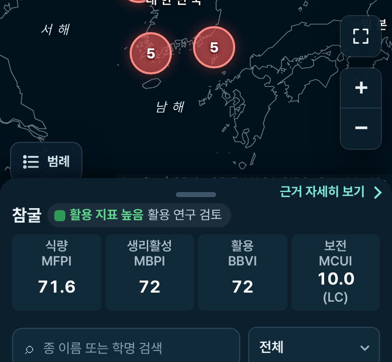
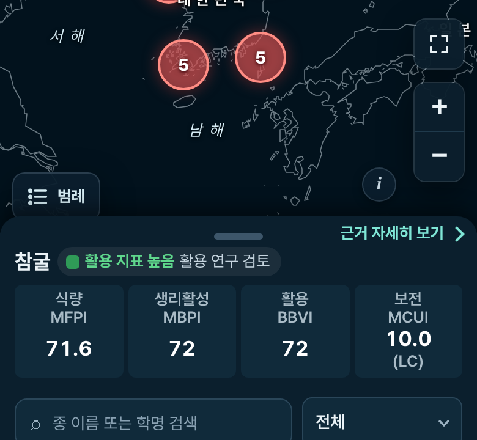
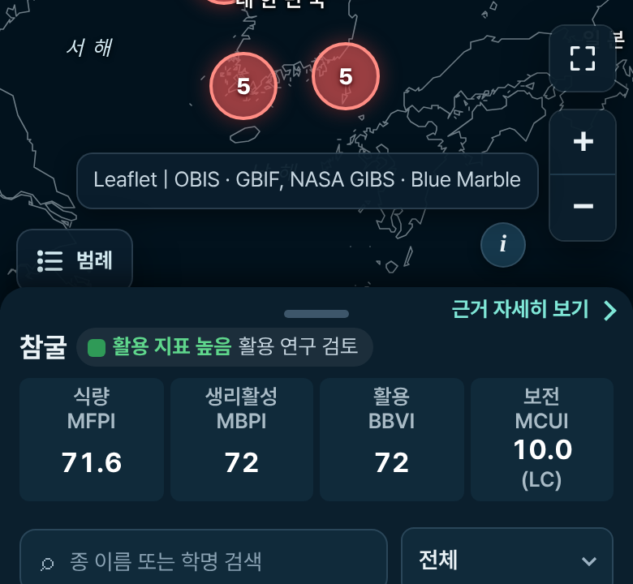
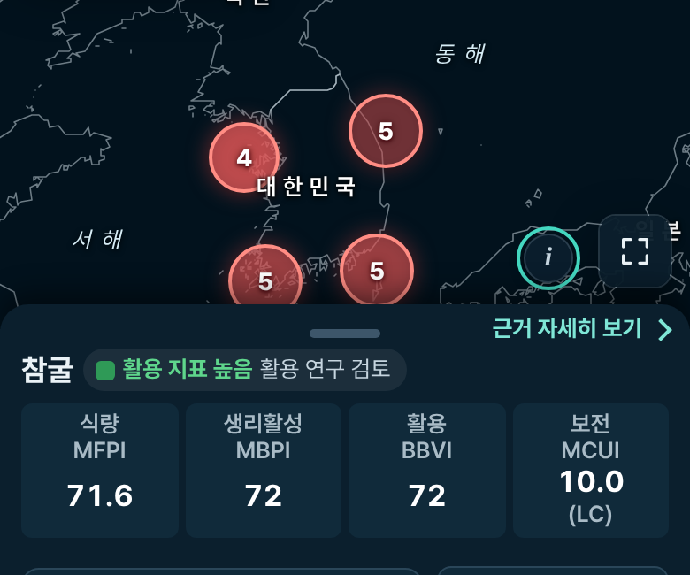
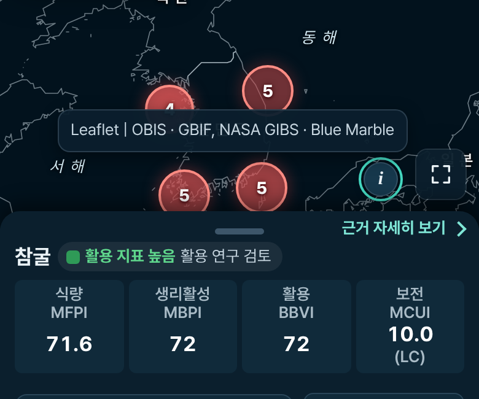
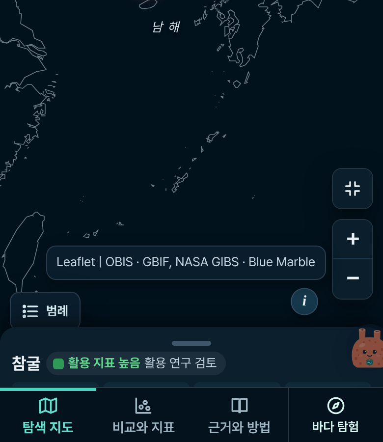
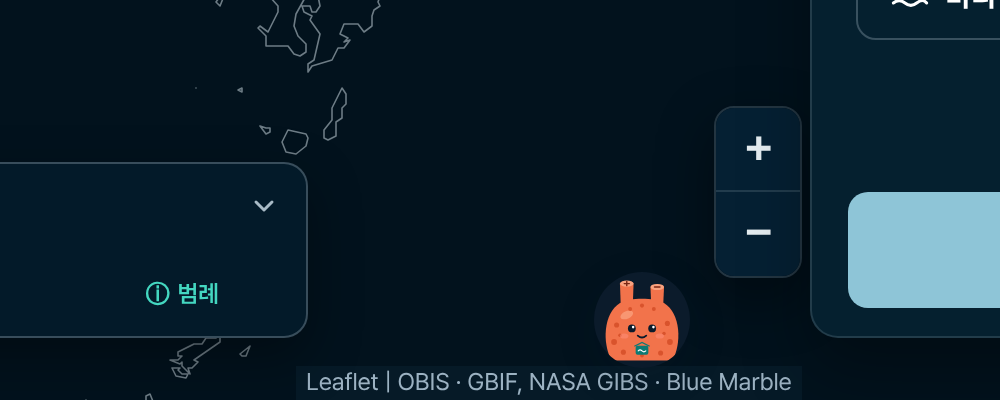

# 2026-10-26 휴대폰 탐색 지도 배경 지도 출처를 ⓘ 단추로 접기

모바일 탐색 지도의 배경 지도 출처를 ⓘ 버튼으로 접음(누르면 펼침). 출처 문구·PC 화면은 그대로.

- 지침: LKH가 보낸 `prompts/map-attribution-info-button-claude-code.md`(저장소에는 `prompts/` 폴더가 없다).
- 기준 커밋: `3a5aca1` (main, #272 병합).
- 범위: 휴대폰(740px 이하). 넓은 화면(741px 이상)은 단추가 없고 출처 줄이 전과 같은 자리·모양이다.

## 먼저 확인한 것

### 1. 배경 타일과 출처 문구, 출처를 만드는 코드

`dist/app.js` `initBasemaps()` · `initMap()`. 출처는 Leaflet 1.9.4 기본 출처 컨트롤(`map.attributionControl`, 오른쪽 아래) 하나다.

| 레이어 | 타일 | Leaflet 출처 문구 |
|---|---|---|
| 접두어 | — | `Leaflet` (`setPrefix('Leaflet')`) |
| 출현 자료 | — | `OBIS · GBIF` (`addAttribution`) |
| 위성(기본) | NASA GIBS WMTS `BlueMarble_ShadedRelief_Bathymetry` | `NASA GIBS · Blue Marble` |
| 수심 | GEBCO WMS `gebco_latest` | `GEBCO_2026 Grid · 항해용 아님` |
| 경계선(타일 실패 때만) | 저장소 안 Natural Earth GeoJSON | (없음, `L.geoJSON`) |

OpenStreetMap·Esri 타일은 쓰지 않는다. 위성 ↔ 수심을 바꾸면 Leaflet이 `layeradd`/`layerremove`에서 출처 글을 다시 쓴다(`_update`가 컨트롤의 `innerHTML`을 통째로 바꾼다).

### 2. 제공처별 출처 표시 조건

| 제공처 | 조건 | 근거 |
|---|---|---|
| GEBCO | "Acknowledge the source of The GEBCO Grid"(문구는 함께 배포하는 문서의 것). 표시 위치나 늘 보이게 하라는 조건은 없다. "should NOT be used for navigation or for any other purpose involving safety at sea" | [GEBCO Grid 이용 조건](https://www.gebco.net/data-products/gridded-bathymetry/terms-of-use) |
| NASA GIBS | 클라이언트에서 쓰거나 발표에서 언급할 때 "We acknowledge the use of imagery provided by services from NASA's Global Imagery Browse Services (GIBS) …"로 밝혀 달라는 요청. 위치·상시 표시 조건은 없다 | [NASA Earthdata GIBS 'Data Use Guidance and Acknowledgements'](https://www.earthdata.nasa.gov/gibs) |
| Leaflet | BSD-2 라이선스는 소스·배포물에 저작권 고지를 남기라는 것이고, 지도 화면의 'Leaflet' 표시를 요구하지 않는다 | `dist/vendor/LEAFLET-LICENSE` |
| OBIS · GBIF | 자료 인용 조건(데이터셋 라이선스, CC BY 등)이며 지도 위 상시 표시 조건은 아니다. 데이터셋별 인용은 '근거와 방법' 탭 출처 목록에 있다 | '근거와 방법' 출처·라이선스 표 |

→ 늘 보여야 하는 제공처 표시는 없어 ⓘ 옆에 따로 남긴 짧은 글은 없다. 두 배경 지도의 이용 고지 원문(GIBS 문장, "Imagery reproduced from the GEBCO_2026 Grid, GEBCO Compilation Group (2026).")과 항해 금지 문장은 '근거와 방법' 탭 `.fine` 문단에 전과 같이 늘 있고, 휴대폰 지도에서도 ⓘ 한 번이면 출처 전체가 보인다.

### 3. 출처 줄이 시트에 덮이던 이유

- 휴대폰에서 지도(`.map-stage`, sticky, 55svh)의 아래 14px를 시트 머리(`.sheet-head`, `margin-top:-14px`, z-index 2)가 덮는다(theme.css 'Design 07').
- 출처 컨트롤은 Leaflet 오른쪽 아래 맨 밑(지도 아래 끝, `bottom:0`)에 있고 휴대폰 글자 크기(`--fs-min` 13px)로 높이 18px이다(390px: 지도 아래 471px, 출처 453–471px, 시트 윗선 457px). 그래서 아래 14px는 시트에 가리고 윗부분 4px만 시트 가장자리 위로 나왔다. 둥근 시트 모서리(16px) 양 끝에서는 조금 더 보였다.
- `mobile-type.css`에는 출처 규칙이 없다. 글자 크기는 style.css·theme.css의 `font-size:var(--fs-min)!important`에서 오고, 휴대폰의 `--fs-min`이 13px이라 줄이 조금 높아졌다.

### 4. 시트 높이를 지도 쪽에 알리는 장치

- 있던 것: `sheetSync()`(스크롤마다 rAF로, 지도 크게 보기 맞춤 뒤, 740px 경계를 넘을 때 불림)가 시트 머리와 지도 아래 끝을 비교해 손잡이 상태를 정한다. 끌기 중에는 `mapFollow()`가 `map.invalidateSize()`를 부른다. CSS 변수는 `--map-full-h`(크게 본 지도 높이)뿐이었다.
- 더한 것: `sheetSync()` 안에서 시트가 지도 아래를 덮은 높이를 `--sheet-cover`(px)로 `.map-stage`에 적는 두 줄. 시트 동작은 바꾸지 않았다.

### 5. 같은 출처가 다른 곳에 있는지

- '근거와 방법' 탭 배경 지도·라이선스 `.fine` 문단: GIBS·GEBCO 이용 고지 원문과 항해 금지 문장. 그대로 둠.
- 탐색 지도 '그 밖의 기능 · 배경 지도 출처' 덩어리: '배경 지도 — 위성: NASA GIBS · 수심: GEBCO 해저 지형 · 경계선: Natural Earth'. 그대로 둠.

## 바뀐 파일

| 파일 | 내용 |
|---|---|
| `dist/map-attribution.css` (새 파일) | 740px 이하에서만: 출처 컨트롤을 확대/축소 단추 왼쪽, 시트 윗선 4px 위(`bottom:calc(var(--sheet-cover,14px) + 4px)`, `right:58px`)에 둔다. 단추는 누르는 칸 44×44px, 보이는 원 28px(탐색 탭 심해 패널 색 · 옅은 글색 · 그림자, 글자 `i`는 `::before`로만). 접힘 = 출처 글 `display:none`, 펼침 = 단추 위 말풍선(13px 이상, 줄바꿈, 최대 폭 `calc(100vw - 74px)`). 출처 컨트롤이 흐름에서 빠지므로 확대/축소 단추 아래 여백 24 → 42px로 자리를 전과 같게. 넓은 화면은 `.attr-toggle{display:none}` 하나. 모든 CSS 중 마지막(`mobile-dedupe.css` 다음) |
| `dist/app.js` | `addAttrToggle()`(Leaflet 출처 컨트롤 안에 단추와 `#map-attr-text` span을 넣고, Leaflet의 `_update`가 그 span에 쓰게 감쌈), `setAttrOpen()`, 닫기(다시 누르기 · 지도 `click` · Esc · 시트 끌기 시작 · 시트가 열 때보다 8px 넘게 올라옴 · 741px 이상으로 넓어짐), `sheetSync()`의 `--sheet-cover` |
| `dist/index.html` | `map-attribution.css` 불러오기, `?v=` 다시 계산(`scripts/i18n_ui_dict.py stamp`) |
| `dist/_headers` | `/map-attribution.css` 1년 캐시(immutable) |
| `dist/i18n-en.js` · `i18n.js` · `expedition.html` | 영어 사전 `배경 지도 출처 보기` → `Show basemap credits`(묶음 '탐색 지도(app.js)'), `?v=` |
| `verification/i18n-ko-baseline.txt` | 한국어 화면 글 기준 다시 만듦: 더해진 줄은 `@aria-label=배경 지도 출처 보기` 하나(main 추출본과 비교해 그 밖은 같음) |
| `verification/test_map_attribution.mjs` (새 파일) · `verify.yml` | 마크업 · CSS · 스크립트 검사, CI에 추가 |
| `verification/uicheck.mjs` | 1440px · 390px 검사 둘(아래) |
| `verification/test_mobile_dedupe.mjs` · `test_mobile_compact.mjs` | 고친 기대값(아래) |
| `verification/2026-10-26-map-attribution-info/check.mjs` | Playwright 점검(전후 비교, 시트 중간 · 지도 크게 보기, 360~1440px) |

더한 요소 · class · 변수: `button.attr-toggle`(`type="button"`, `aria-expanded`, `aria-controls="map-attr-text"`, `aria-label="배경 지도 출처 보기"`, 글자 없음), `span#map-attr-text.attr-text`(Leaflet이 출처를 쓰는 곳), 컨트롤의 `.attr-open`, `.map-stage`의 `--sheet-cover`.

탐색 지도 `#explore` `textContent`는 390px · 1440px 모두 main과 같다(단추에 글자가 없고 출처 글은 span으로 옮겨졌을 뿐).

## 캡처 (Chromium, 390×844 · 1440×900, dpr 2, 지도 아래만 자름)

| | |
|---|---|
| 전 390px: 출처 줄 윗부분이 시트 가장자리 위로 나옴 |  |
| 후 390px 시트 접힘 · ⓘ 닫힘 |  |
| 후 390px 시트 접힘 · ⓘ 열림 |  |
| 후 390px 시트 중간(160px 올림) · ⓘ 닫힘(올리면서 접힘) |  |
| 후 390px 시트 중간 · ⓘ 열림 |  |
| 후 390px 지도 크게 보기 · ⓘ 열림 |  |
| 전 1440px |  |
| 후 1440px(전체 화면 캡처가 전과 픽셀까지 같음) |  |

## 검사

- `node verification/2026-10-26-map-attribution-info/check.mjs`(SUPA=fixture, 타일은 작은 그림으로 대신): 25개 모두 통과. 390 접힘 · 이름 · `aria-expanded`, 시트 · 범례 · 확대/축소 · 지도 크게 보기와 겹치지 않음(44×44), 펼침 말풍선이 화면 · 지도 안(좌우 16px 여백), Esc(포커스 단추에 남음) · 지도 빈 곳 · 다시 누르기로 닫힘, 수심 ↔ 위성 전환에 따라 펼친 출처가 바뀜, Enter · Space, 시트 중간 · 다시 내림 · 지도 크게 보기에서 단추가 시트 윗선을 따라감, 시트를 다 올리면 단추가 시트 밑, 콘솔 오류 없음, 1440 출처 줄 자리 · 확대 단추 자리 전과 같음, 390 확대 · 크게 보기 단추 자리 전과 같음, `textContent` 같음, 360 · 430 · 740 · 741 · 1024 · 1440 가로 넘침 없음.
- `uicheck.mjs`에 더한 검사: 'Wide 1440px (map attribution)', 'Mobile map attribution'.
- CI 단위 검사 전부(`verify.yml`의 `node verification/test_*.mjs` · `build_*.py --check` · `python -m unittest discover -s verification -p 'test_*.py'`, Python 3.12) 통과.

### 고친 검사 / 지운 검사 / 건너뛴 검사

- 고친 검사: `test_mobile_dedupe.mjs`('mobile-dedupe.css가 마지막 스타일시트' → map-attribution.css 바로 앞), `test_mobile_compact.mjs`(이 파일 뒤에 오는 것에 map-attribution.css 더함). 지침이 map-attribution.css를 모든 CSS 중 마지막에 두라고 해서다.
- 출처가 보인다고 기대하던 검사는 없었다(`verification/`에서 `attribution`, `leaflet-control-attribution`, `Esri`, `OpenStreetMap`, `©`, `출처`로 찾음: 다른 자료원의 인용 검사만 걸렸다).
- 지운 검사 · 건너뛴 검사: 없다.

## 직접 확인하지 못한 것

- iOS Safari 실제 기기와 Android Chrome 실제 기기에서는 보지 못했다. 이 클라우드 환경에는 휴대폰이 없고, WebKit(Playwright) 내려받기도 네트워크 정책에 막혔다(`cdn.playwright.dev`, `playwright.azureedge.net` 403). 확인은 Chromium의 휴대폰 흉내(390×844, 터치, Android UA)로만 했다. `BROWSER=webkit node …/check.mjs`로 WebKit에서 같은 점검을 돌릴 수 있다.
