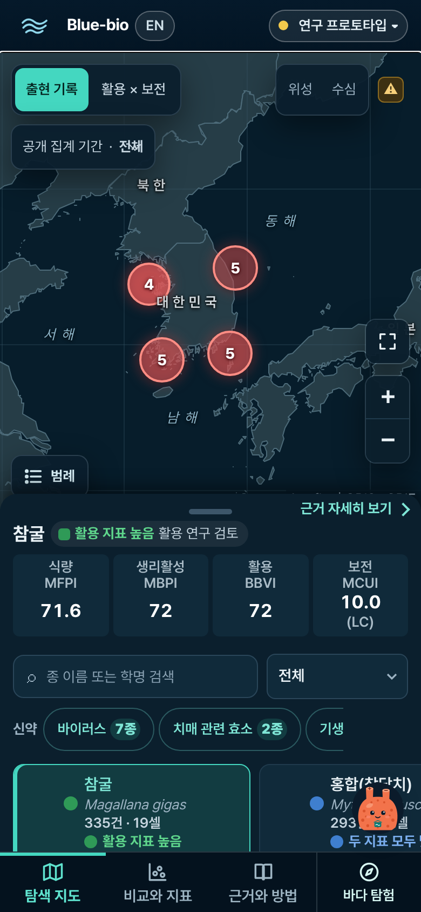
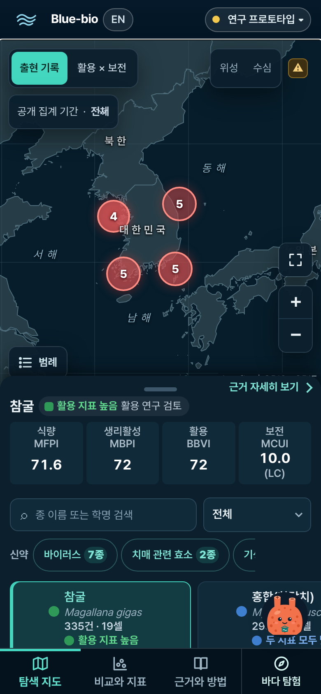
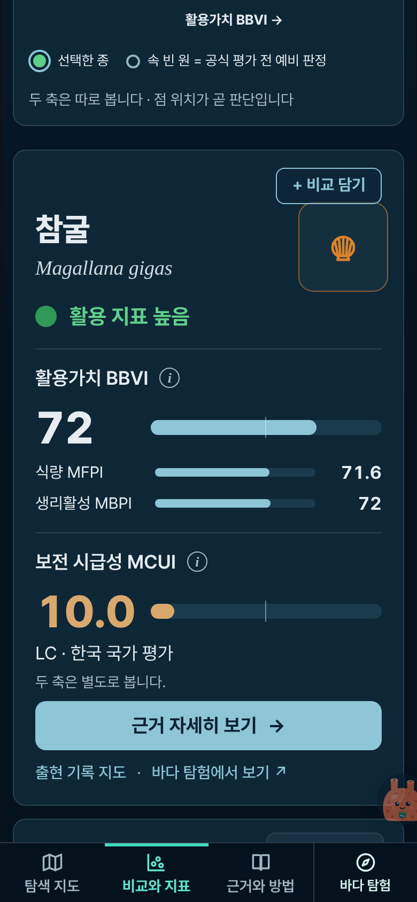
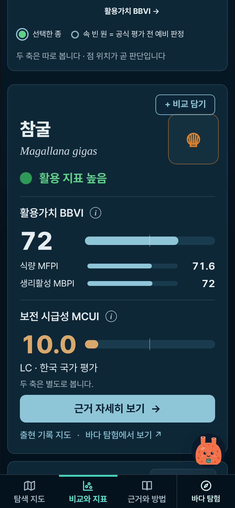
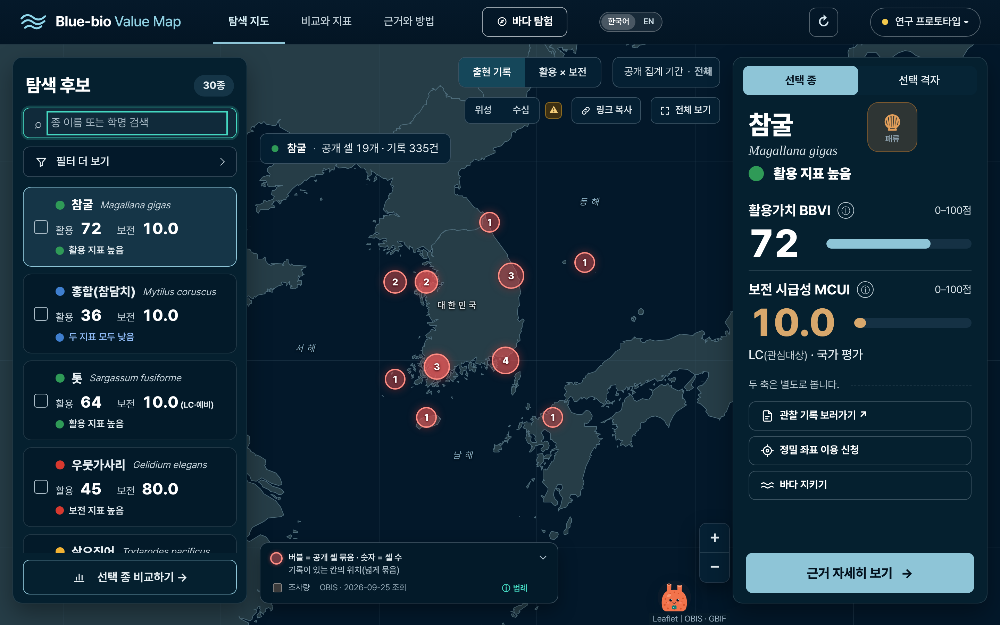
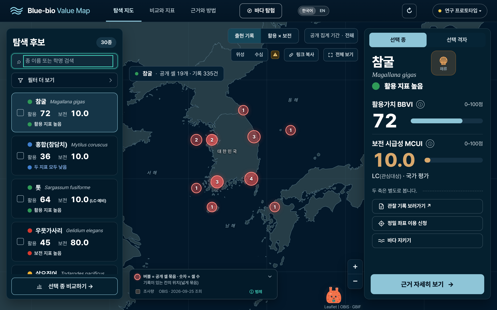
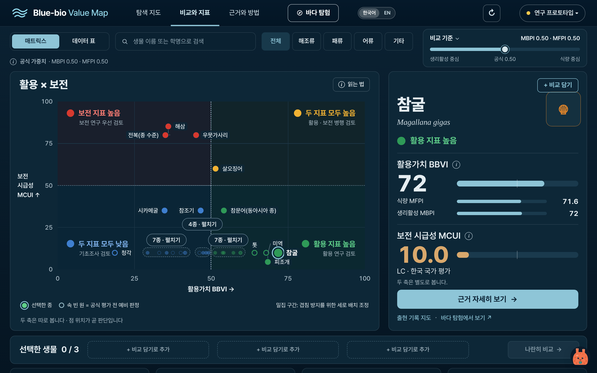
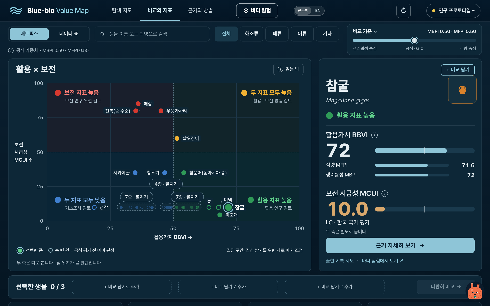

# 멍이 버튼 키우기 + 끌어서 원하는 자리로 옮기기 (2026-10-26)

멍이를 52px로 키우고 끌어서 옮길 수 있게 함(자리 기억, 키보드 이동·초기화, 스크롤 중 흐려짐 포함). 그림·동작·문구는 그대로.

- 기준 커밋: main `3a5aca1` (PR #272 병합)
- 지침: [`prompt-original.md`](prompt-original.md) (LKH가 보낸 `prompts/meongi-bigger-draggable-claude-code.md`, 저장소에는 `prompts/` 폴더가 없다)
- 점검: [`check.mjs`](check.mjs) 33개 통과([`after/result.json`](after/result.json)), 캡처 [`capture.mjs`](capture.mjs), 길이 재기 [`measure.mjs`](measure.mjs)

## 먼저 확인한 것

1. **마크업·위치·크기**: `dist/chatbot.js`가 `
` 안에 `button.bbc-fab`(멍이 버튼), `.bbc-hint`(첫 안내 말풍선), `section.bbc-panel`(대화창)을 만들어 `body` 끝에 붙인다. 버튼은 `dist/chatbot.css`의 `.bbc-fab{position:fixed;right:var(--bbc-right);bottom:calc(16px + var(--bbc-bar,0px));width:48px;height:48px}`, 옮겼으면 `.bbc-moved .bbc-fab{left:var(--bbc-x);top:var(--bbc-y)}`. `--bbc-right`는 `place()`가 정한다(16px, 768px 이상 탐색 지도에서는 확대/축소 컨트롤 왼쪽).
2. **누르면 여는 것**: 깡충 인사(0.6초) 뒤 대화창(`.bbc-panel`, 사용법 안내 도우미). 767px 이하는 화면 아래 시트, 768px 이상은 버튼 옆 360×520 창. 옮긴 버튼이면 `chatbotPanelPlace`가 버튼 기준으로 넓은 쪽(왼쪽 절반이면 오른쪽으로, 아래쪽 절반이면 위로)에 화면 안으로 연다. 이번에 바꾸지 않았다.
3. **나오는 화면**: `index.html`의 세 탭(탐색 지도·비교와 지표·근거와 방법)과 첫 화면 뒤 전부 같은 코드 하나. `expedition.html`(바다 탐험)은 `chatbot.js`를 불러오지 않아 멍이가 없다. 그래서 `index.html`만 바꿨다.
4. **주변과의 간격(고치기 전)**: 390px에서 버튼 오른쪽 16px, 아래 탭 줄(`--bbc-bar` = 56px + `env(safe-area-inset-bottom)`) 위 16px. 탐색 지도의 아래 시트는 페이지 스크롤 그 자체(`app.js` 4692행: 시트를 끄는 것 = 페이지 스크롤)라 위로 올라오는 고정 상자가 아니고, 종 카드 줄 끝에 56px 여백을 두어 비켰다(#272). 비교 탭 담기 트레이는 비었을 때는 페이지 안(static), 담으면 아래 고정 막대(`right:72px`, 멍이 왼쪽에서 끝남). 1440px은 아래 16px.
5. **움직임**: 버튼 안 멍이는 숨쉬기·깜빡임·물방울(가만히), 누르면 깡충. 이미 끌어서 옮기기(#160, `bbChatFabPos`)와 휴대폰 스크롤 중 가장자리로 접기(#272, `.bbc-tucked`)가 있었다. '움직임 줄이기'(사이트 스위치 `bbvm-reduce-motion=1` 또는 `prefers-reduced-motion:reduce`)이면 멍이 움직임과 접는 전환이 없다.

**기존 장치와 이번 작업이 맞물리는 방식**: 새로 겹쳐 만들지 않고 `chatbot.js`의 기존 끌기(포인터 이벤트·`setPointerCapture`·끌기 뒤 click 한 번 무시·Esc 취소)와 스크롤 감지(document `scroll` capture·passive 한 리스너)를 그대로 고쳐 썼다.

| 기존(#160·#272) | 이번 |
|---|---|
| 문턱: 마우스 6px 초과, 손가락·펜 10px 초과 | 셋 다 **8px 이상** (`CHATBOT_DRAG.threshold`) |
| 놓은 자리 그대로(어디든) | 놓으면 **가까운 좌우 가장자리로 붙음**, 세로는 놓은 자리 |
| 범위: 화면 + safe-area 안 8px | **헤더 아래 ~ 아래 탭 줄 위**, 좌우 8px 안 (`view()`의 inset) |
| 저장: `bbChatFabPos` = `{desktop|mobile:{h,x,v,y}}` | `bbMeongiPos` = `{side,y}` 한 항목 (옛 값은 한 번 옮기고 지움) |
| 휴대폰 스크롤 중 `.bbc-tucked`(가장자리로 55% 밀어 넣기, 지도 끌기에도), 700ms 뒤 복귀, 접힌 버튼 누르기는 펼치기만 | 모든 폭에서 `.bbc-fab.is-scrolling`(자리 그대로 흐려지기), 지도 끌기·확대는 해당 없음, **400ms** 뒤 복귀, 흐려진 채 눌러도 바로 원래대로 돌아오며 연다 |
| 대화창이 열린 채 끌면 대화창이 따라감(PC) | 끌기를 시작하면 대화창을 닫음 |
| 커서 pointer | PC 마우스에서 grab / 끄는 동안 grabbing |
| 키보드 없음(대화창의 '멍이 원래 자리로'만) | Shift+방향키·Shift+Home 더함, '멍이 원래 자리로'도 그대로 |

## 크기 (전 → 후)

| | 390px | 1440px |
|---|---|---|
| 버튼 = 누르는 영역 | 48×48 → **56×56** | 48×48 → **56×56** |
| 버튼 안 멍이 그림(SVG 상자) | 44 → **52px** | 44 → **52px** |
| 그 안의 멍이 몸 폭(지침의 '38px 안팎') | 약 40 → 약 47px | 같음 |
| 기본 자리 | 오른쪽 16, 탭 줄 위 16 → 오른쪽 16, **탭 줄 위 12** | 오른쪽 16(탐색 지도는 확대/축소 왼쪽), 아래 16 그대로 |

- 지침은 "지금 38px 안팎 → 52px 안팎(약 1.35배), 누르는 영역 56px 이상"이었다. 재 보니 38px은 버튼 안 멍이 몸 폭이고 버튼 자체는 이미 48px이었다. 그림(SVG)을 **52px**, 버튼(누르는 영역)을 **56px**로 맞춰 지침의 두 숫자를 그대로 지켰다(그림 1.18배, 버튼 1.17배). 버튼을 1.35배(65px)로 키우면 PC 상한 64px를 넘고 휴대폰에서 가리는 면적이 커진다.
- PC는 48px로 52px보다 작아 같은 규칙으로 56px(64px 이하).
- 그림은 SVG(`chatbotMascot`, viewBox 크롭)라 키워도 흐려지지 않는다. 새 그림은 만들지 않았고 그림·표정·색·움직임은 그대로다(`svg` `width/height` 속성은 44 그대로, CSS가 52px로 그린다).
- 비키는 장치: 탭 줄은 기존 `--bbc-bar`를 그대로 쓴다. 담기 트레이는 고정 막대의 오른쪽 끝을 72 → 80px로(56px 버튼 왼쪽에서 끝남), 왼쪽으로 옮긴 멍이가 트레이와 겹치면 트레이 위로 비킨다(`movedPos`, 트레이 크기가 바뀌면 `ResizeObserver`로 다시 놓음). 탐색 지도 시트는 페이지 스크롤이라 비킬 것이 없고, 종 카드 줄 끝 여백(56 → 64px), 활용 특성 칩 줄 끝(60 → 68px), 맨 아래 body 여백(48+16 → 56+12px), 첫 안내 말풍선 자리를 56px 버튼에 맞췄다.

## 끌기 규칙 최종값

| 항목 | 값 |
|---|---|
| 끌기 시작 | 누른 점에서 **8px 이상**(마우스·손가락·펜 같음). 그보다 적게 움직이고 떼면 누르기(지금처럼 열기·닫기). 끌기로 끝나면 누르기 동작 없음 |
| 길게 누르기 | 필요 없음. `touch-action:none`(chatbot.css) + `setPointerCapture`, 버튼의 pointer 이벤트는 위로 올리지 않음(`stopPropagation`). 버튼은 지도 상자 밖(`body` 끝)이라 Leaflet은 처음부터 받지 않는다 |
| 놓을 수 있는 범위 | 위: 헤더(`.header`) 높이 + 8px, 아래: 아래 탭 줄(휴대폰 고정) 위 8px, 좌우 8px 안(+ safe-area). 밖으로 끌면 가장자리에 붙어 멈춤 |
| 놓으면 | 가까운 좌우 가장자리(버튼 가운데가 화면 가운데보다 왼쪽이면 왼쪽)에서 **16px**. 오른쪽은 기본 자리와 같은 거리(PC 탐색 지도는 확대/축소 컨트롤 왼쪽 줄). 세로는 놓은 자리 |
| 붙는 움직임 | `left`·`top` **0.2초** ease-out(`.bbc-snap`, 260ms 뒤 뗌). 움직임 줄이기면 바로 |
| 끄는 동안 | 1.08배·진한 그림자(chatbot.css `.bbc-dragging` 그대로), 문서 글자 선택 막음(`.bbc-drag-doc`), PC 커서 grabbing, 버튼 `draggable="false"`·`dragstart` 막음 |
| 대화창 | 열린 채 끌기를 시작하면 닫힘. 왼쪽에 붙은 멍이를 누르면 대화창은 멍이 왼쪽 끝에 맞춰 오른쪽으로 펼침(기존 `chatbotPanelPlace`) |
| 키보드 | 멍이에 포커스가 있을 때 **Shift+↑/↓ 16px**, **Shift+←/→ 그 가장자리로**, **Shift+Home 기본 자리(저장값 지움)**. Enter·Space는 그대로 누르기. `aria-keyshortcuts`에 적음 |
| 두 번 눌러 되돌리기 | **넣지 않음**: 첫 누르기가 깡충 뒤 대화창을 열고(휴대폰은 시트가 버튼을 덮음) 두 번째 누르기가 닫기가 되어 겹친다. 키보드 Shift+Home과 대화창의 '멍이 원래 자리로'로 되돌린다 |
| 접근 가능한 이름 | `사용법 안내 열기` / `사용법 안내 닫기` 뒤에 `. 끌거나 Shift와 방향키로 옮길 수 있습니다`(영어 사전 `i18n-en.js`에 두 줄 더함). 옮긴 뒤 실시간 알림은 없음 |

## 스크롤하는 동안 흐려지기

| 항목 | 값 |
|---|---|
| 감지 | `document`에 `scroll` 리스너 하나(capture, `passive:true`): 페이지, 각 탭의 스크롤 상자, 종 카드 줄 가로 스크롤을 함께 받는다. 대화창 안 스크롤은 뺀다. 지도 끌기·확대는 scroll이 아니라 흐려지지 않는다(#272의 지도 `movestart` 연결은 지웠다) |
| 모양 | `.bbc-fab.is-scrolling`: 불투명도 **.35**, **0.85배**. 기준점(`transform-origin`)은 붙은 가장자리 쪽(오른쪽이면 `100% 50%`, 왼쪽이면 `0 50%`)이라 자리는 그대로 보인다. `left`/`top`은 바뀌지 않는다 |
| 시간 | 줄고 돌아오는 전환 0.18초, 마지막 스크롤 **400ms** 뒤 뗌(디바운스 타이머) |
| 성능 | 스크롤마다 타이머를 다시 걸 뿐이고 레이아웃을 읽지 않는다. 클래스는 `requestAnimationFrame`으로 한 프레임에 한 번 |
| 그대로 두는 때 | 대화창이 열렸을 때, 깡충 중, 끄는 중, 버튼이 `:focus-visible`일 때 |
| 흐려진 채 누르기·끌기 | 누르는 순간 전환 없이 원래 크기로 돌아오고, 지금처럼 열기·끌기 |
| 움직임 줄이기 | 크기는 줄이지 않고 불투명도만 전환 없이 바뀜 |

## 저장 형식

- `localStorage['bbMeongiPos'] = {"side":"left"|"right","y":0.4986}` — `y`는 **버튼 가운데 높이 ÷ 화면 높이**(0~1, 소수 4자리). 비율이라 화면 크기가 바뀌어도 비슷한 높이에 놓인다. PC와 휴대폰이 같은 값을 쓴다.
- 읽기·쓰기는 모두 `try/catch`. 저장이 막힌 환경(비공개 창 등)은 기본 자리로 시작하고 옮긴 자리는 그 탭에서만 기억한다.
- 화면 크기가 바뀌어(회전·창 크기·트레이) 범위 밖이 되면 가장 가까운 범위 안에 그리되 저장값은 사용자가 다시 옮길 때까지 그대로.
- 2026-10-26 전에 옮긴 사람의 `bbChatFabPos`는 처음 열 때 지금 폭의 값(없으면 다른 폭 값)을 `{side,y}`로 한 번 옮기고 지운다.

## 바뀐 파일

| 파일 | 내용 |
|---|---|
| `dist/meongi.css` (새 파일) | 크기·기본 자리·흐려지기·붙기 전환·grab 커서·말풍선/대화창/여백/트레이 간격. 모든 CSS 중 마지막에 불러와 같은 선택자로 덮어쓴다 |
| `dist/chatbot.js` | 문턱 8px, `{side,y}` 저장(`chatbotFabSide`·`chatbotFabFromSide`·`chatbotReadMeongiPos`), 범위(헤더·탭 줄), 트레이 비키기, 접기 → 흐려지기, 끌기 시작 시 대화창 닫기, Shift+방향키·Shift+Home, `aria-label` 덧붙임 |
| `dist/chatbot.css` | 더는 쓰지 않는 `.bbc-tucked` 두 줄과 그 전환 한 줄을 지움(크기 규칙은 그대로 두고 meongi.css가 덮어씀) |
| `dist/index.html` | `meongi.css`를 `mobile-dedupe.css` 다음(마지막)에, `chatbot.*`·`i18n.js`·`meongi.css`의 `?v=` 다시 계산 |
| `dist/_headers` | `/meongi.css` 1년 immutable |
| `dist/i18n-en.js`, `dist/i18n.js`, `dist/expedition.html` | 새 `aria-label` 두 줄의 영어(`scripts/i18n_ui_dict.py add`), 사전 `?v=`(`stamp`) |
| `verification/i18n-ko-baseline.txt` | 한국어 화면 기준: 멍이 `aria-label` 한 줄만 바뀜 |

`scripts/`, `config/`, `dist/*.json`, 지표 값, 탭 글자, 대화창 내용·문구, 아래 탭 줄·시트·트레이·지도 동작은 그대로다. 세 탭 `textContent`가 main과 같다(`check.mjs`).

## 검사

고친 검사(기대값만 고침, 지운 검사·건너뛴 검사는 없다):

| 검사 | 고친 것 |
|---|---|
| `test_chatbot_drag.mjs` (1) | 문턱 기대값 6/10px 초과 → 8px 이상. (2)~(6)은 그대로, (7) `{side,y}` 왕복·가장자리·깨진 값, (8) meongi.css(마지막·`?v=`·캐시·56/52px·12px 미만 글자 없음) 더함 |
| `test_mobile_dedupe.mjs` | 마지막 스타일시트 `mobile-dedupe.css` → `meongi.css`, mobile-dedupe는 그 바로 앞 |
| `test_mobile_compact.mjs` | mobile-compact 뒤에 오는 것에 `meongi.css` 더함 |
| `test_client_outdated.mjs` | `?v=` 검사 목록에 `meongi.css` 더함 |
| `uicheck.mjs` M-2·M-3·M-4·M-6 | 놓은 자리 x 36/26 → 16(가장자리 붙기), y는 놓은 높이, 작은 창은 같은 비율 높이, 저장 키 `bbMeongiPos`, 휴대폰 56px |
| `uicheck.mjs` M-6b | 가장자리로 접기 → 자리 그대로 흐려지기(.35), 흐려진 채 누르면 대화창이 열림, 0.4초 뒤 복귀 |
| `uicheck.mjs` M-5b (새로) | Shift+↑ 16px, Shift+← 왼쪽, Shift+Home 기본 자리·저장값 지움 |

`check.mjs` (Chromium, 390은 Android Chrome 흉내·CDP 터치, 1440은 마우스): 33개 통과.

- 390: 누르는 영역 56×56·그림 52·오른쪽 16·탭 줄 위 12(겹침 없음), `aria-label`, 3px 움직이고 떼면 열림·자리 그대로, 40px 끌면 안 열리고 가장자리에 붙고 세로는 놓은 자리, 왼쪽 절반 → 왼쪽, 헤더 위·탭 줄 아래·화면 밖으로 끌어도 범위 안, 지도 위에서 끄는 동안·뒤 `map.getCenter()`·확대 그대로, 시트 위에서 끄는 동안·뒤 시트·지도 높이·스크롤 그대로, 다시 불러와도 같은 자리, 390 → 768 → 390 화면 안·저장값 그대로
- 흐려지기: 페이지 스크롤 중 `is-scrolling`(.35·0.85배), 계속 스크롤하면 유지, 멈추고 약 0.4초 뒤 뗌, `left/top` 그대로, 오른쪽 끝 그대로, 종 카드 줄 가로 스크롤도 같음, 흐려진 채 누르면 바로 원래대로·열림, 손가락 지도 끌기·확대에는 안 붙음, 키보드 포커스면 안 흐려짐
- `localStorage`를 막아도 오류 없이 기본 자리, 끌기는 그 탭에서 됨 / 움직임 줄이기: 붙기 전환 없음, 스크롤 때 크기 그대로·불투명도만
- 1440: 56×56·52·아래 16·커서 grab, 마우스 끌기 중 grabbing·1.08배·놓으면 왼쪽·지도 그대로·글자 선택 없음, 3px 누르기는 열기·대화창은 오른쪽으로 펼침, 열린 채 끌면 닫힘, Shift+↑↓←→·Shift+Home, Enter는 열기, 지도 마우스 끌기·휠 확대에는 안 흐려짐, 비교 탭 스크롤엔 흐려짐
- 360·390·414·768·1024·1280·1440 × 세 탭 가로 넘침 없음, 멍이 화면 안, 콘솔 오류 없음(막아 둔 지도 타일 요청 제외), 세 탭 `textContent`가 main과 같음

CI 전체(`verify.yml`): 단위 검사 41개 `node verification/test_*.mjs`, `build_*.py --check` 다섯, Python `unittest` 496개(3.12) 모두 통과. `uicheck.mjs`(FIXTURE)는 PR 본문에 결과를 적는다. 늘 나오는 환경 FAIL 4개(위성 GIBS·수심 GEBCO 타일, 예전 '기본' 저장값, A-5 공유 링크)는 클라우드에서 지도 타일이 막혀서다.

## 직접 확인하지 못한 것

- **실제 iPhone(iOS Safari)·Android 기기에서는 확인하지 못했다.** 클라우드에서 WebKit(Playwright)을 내려받으려 했지만 다운로드가 막혀 돌리지 못했다. 휴대폰은 Chromium의 휴대폰 흉내(CDP 터치)로만 봤다. `check.mjs`에 `ENGINE=webkit`으로 휴대폰 부분을 다시 보는 길을 남겨 두었다.
- 성능 기록(스크롤 중 긴 작업)은 따로 재지 않았다. 스크롤마다 하는 일은 타이머 다시 걸기뿐이라 구조로 판단했다.

## 캡처

| | 전 | 후 |
|---|---|---|
| 390 탐색 지도(기본 자리) |  |  |
| 390 비교와 지표(기본 자리) |  |  |
| 1440 탐색 지도 |  |  |
| 1440 비교와 지표 |  |  |

- 왼쪽으로 옮긴 모습: [`after/390-explore-left.png`](after/390-explore-left.png), [`after/1440-explore-left.png`](after/1440-explore-left.png), 대화창이 오른쪽으로 펼쳐진 모습 [`after/1440-left-open.png`](after/1440-left-open.png)
- 끄는 모습(390, 손가락으로 오른쪽 아래 → 왼쪽 위, 놓으면 왼쪽 가장자리에 붙고, 이어서 스크롤하면 흐려졌다 돌아옴): [`after/meongi-drag-390.gif`](after/meongi-drag-390.gif)
